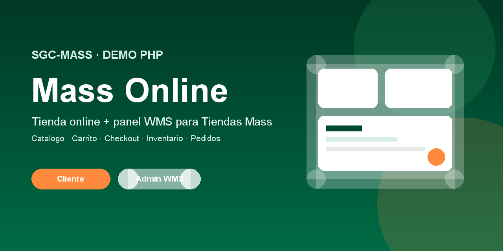
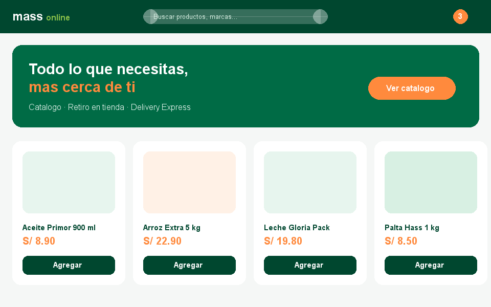
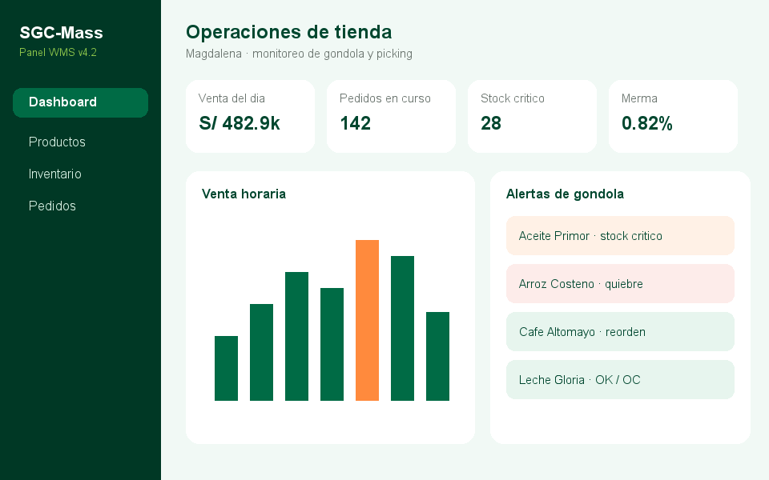

# Mass Online · SGC-Mass



**Demo PHP** de e-commerce y operaciones para *Tiendas Mass*:
catálogo, carrito, checkout (retiro / delivery) y panel admin WMS (inventario, pedidos, productos).


---

## ¿Qué es este proyecto?

**Mass Online** es el portal de compra del cliente (storefront).  
**SGC-Mass** es el panel de control de tienda (WMS / góndola / picking).

Todo corre en **PHP puro** (sin Laravel ni frameworks JS). La persistencia pasa por `backend/Database.php`: PDO a **MySQL/MariaDB** en modo `mysql`, datos de sesión en modo `demo`, y aviso de fallo en modo `error` (ese fallo no vuelve a cargar el demo). Ideal para prácticas de:

- reglas de negocio (retiro vs express, cupones, validación de pedidos)
- calidad de software (PHPUnit + suites CLI en `/tests`)
- UX de checkout y panel operativo

| Módulo | Ruta | Para quién |
|--------|------|------------|
| Tienda online | `cliente_interfaces/` → `frontend/views/cliente/` | Cliente / proveedor de pedidos |
| Panel WMS | `admin/` → `frontend/views/admin/` | Administrador de operaciones |
| Backend | `backend/` | Config, repositorios PDO, middleware, controladores y API JSON |
| Núcleo | `includes/` | Auth, carrito, checkout, fallback demo |
| Pruebas | `tests/` | Validación de reglas |
| Prompts | `PROMTS/` | Prompts versionados del proyecto |

---

## Vistas principales

| Tienda Mass Online | Admin SGC-Mass |
|:---:|:---:|
|  |  |

*Izquierda:* storefront (hero, catálogo, carrito) · *Derecha:* dashboard WMS (KPIs, alertas de góndola)

### Flujo cliente
1. Catálogo y ficha de producto (PDP)
2. Carrito con cupones Club Mass
3. Checkout en 3 pasos: canasta → entrega/retiro → pago
4. Confirmación con tracking (retiro en tienda **o** delivery express)

### Flujo admin
1. Login SGC-Mass (admin WMS / cliente)
2. Dashboard de venta, pedidos y stock crítico
3. Catálogo admin (alta/edición con reglas EAN, margen, ABC)
4. Inventario y cola de picking / pedidos

---

## Requisitos

- **PHP 8.1+** (XAMPP / MAMP / servidor local)
- Extensiones habituales de PHP (`session`, `mbstring`, `pdo_mysql` si usas BD)
- Composer (para PHPUnit)
- Navegador moderno

## Cómo ejecutar

1. Copia el proyecto a tu servidor local, por ejemplo:
   - XAMPP → `htdocs/paginaweb` (o el nombre de carpeta que uses)
2. Abre:
   - **Tienda:** `http://localhost/<carpeta>/` → redirige a `cliente_interfaces/`
   - **Admin:** `http://localhost/<carpeta>/admin/login.php`
3. Atajo demo de checkout:  
   `cliente_interfaces/pedido.php?demo=1` (carga una canasta de ejemplo)

### MySQL opcional (XAMPP)

1. Arranca Apache + MySQL
2. Importa `database/schema.sql` y luego `database/seed.sql`
3. Copia `backend/config/database.example.php` → `backend/config/database.local.php`  
   (deja `"enabled" => true`; ese archivo no se sube a Git)

Sin `database.local.php`, o con `"enabled" => false`, y sin forzar `MASS_USE_DB=1`, el modo es demo: la sesión y el catálogo de `includes/data.php` no se guardan en MySQL. Si el archivo local pide base (`enabled` true) o `MASS_USE_DB` vale `1`/`true`, la aplicación intenta PDO. Si esa conexión falla, el modo queda en `error` y los datos demo no ocupan el lugar de la base.

#### Importación y verificación de la base de datos `mass_online`

**1. Preparar MySQL/MariaDB en XAMPP**

- Abre el *XAMPP Control Panel* y pulsa **Start** en *MySQL* (MariaDB 10.4+ incluido en XAMPP).
- Comprueba la conexión: `C:\xampp\mysql\bin\mysql.exe -u root -e "SELECT VERSION();"`

**2. Configurar credenciales locales**

```bash
copy backend\config\database.example.php backend\config\database.local.php
```

Ajusta `host`, `port`, `user` y `pass` si tu MySQL no usa `root` sin contraseña. `database.local.php` está en `.gitignore`: no subas credenciales reales al repositorio.

**3. Crear la base e importar `schema.sql`**

`schema.sql` crea la base `mass_online` (`utf8mb4` / `utf8mb4_unicode_ci`) y las 9 tablas: `roles`, `usuarios`, `categorias`, `productos`, `tiendas`, `inventario`, `cupones`, `pedidos`, `pedido_detalles`.

> ⚠️ `schema.sql` ejecuta `DROP TABLE IF EXISTS` sobre esas 9 tablas. Si ya tienes datos propios en `mass_online`, haz una copia antes (`mysqldump -u root mass_online > respaldo.sql`).

```bash
C:\xampp\mysql\bin\mysql.exe -u root --default-character-set=utf8mb4 < database/schema.sql
```

**4. Importar `seed.sql`**

```bash
C:\xampp\mysql\bin\mysql.exe -u root --default-character-set=utf8mb4 < database/seed.sql
```

El seed vacía las 9 tablas, reinicia los `AUTO_INCREMENT` e inserta los datos demo con `id` fijos (2 roles, 4 usuarios, 7 categorías, 15 productos, 4 tiendas, 15 filas de inventario en Magdalena y 2 cupones). Puede reimportarse las veces que haga falta con el mismo resultado.

En **phpMyAdmin** (`http://localhost/phpmyadmin`): pestaña *Importar* → `database/schema.sql` → *Continuar*; luego lo mismo con `database/seed.sql` (codificación `utf-8`).

> En PowerShell usa `cmd /c "C:\xampp\mysql\bin\mysql.exe -u root --default-character-set=utf8mb4 < database\seed.sql"`: el operador `<` no existe en PowerShell y `Get-Content | mysql` puede alterar los acentos.

**5. Ejecutar la verificación automática**

```bash
php scripts/verificar_bd.php
php scripts/verificar_bd.php --dbname=otra_base   # opcional: verificar otra base
```

El script usa las credenciales de `database.local.php` y comprueba conexión PDO, charset `utf8mb4`, las 9 tablas y sus columnas, conteos por tabla, valores clave frente a `includes/data.php` (productos, categorías, tiendas, inventario, cupones, usuarios), las 7 claves foráneas y sus reglas `ON DELETE`, índices `PRIMARY`/`UNIQUE`/`INDEX`, registros huérfanos y doble codificación de acentos. Además intenta escrituras inválidas (FK inexistente, duplicados, `NOT NULL`) dentro de transacciones que siempre se revierten, para confirmar que el motor las rechaza.

**6. Interpretar los resultados**

| Nivel | Significado |
|-------|-------------|
| `[OK]` | La comprobación coincide con el esquema o con los datos demo. |
| `[ERROR]` | Discrepancia real: falta una tabla, un registro, una FK o un índice, o un valor no coincide. |
| `[ADVERTENCIA]` | Diferencia legítima que conviene revisar (p. ej. pedidos creados por la app o campos de `data.php` que no existen en el esquema). |

La última línea muestra `RESULTADO: VERIFICACION_BD_OK` (código de salida `0`) o `VERIFICACION_BD_FAIL` (código `1`). Sin conexión termina con código `2`.

Con el seed recién importado el resultado esperado es `OK=93 ERROR=0 ADVERTENCIA=3`. Las tres advertencias son diferencias conocidas de los datos demo: campos de tienda que solo existen en `data.php` (`distancia`, `lat`, `lng`…), inventario por producto definido solo para Magdalena, y la etiqueta fija `count=8` del filtro *Abarrotes* en `mass_filtros_catalogo()` frente a los 7 productos reales.

**7. Regenerar `seed.sql` desde los datos demo**

```bash
php scripts/generate_seed.php                     # sobrescribe database/seed.sql
php scripts/generate_seed.php ruta/seed_prueba.sql # escribe en otra ruta (pruebas)
```

El generador fuerza `MASS_USE_DB=0`, así que siempre parte de `includes/data.php` aunque `database.local.php` esté activo.

**Errores comunes de importación**

| Error | Causa | Solución |
|-------|-------|----------|
| `ERROR 2002 (HY000): Can't connect to MySQL server` | MySQL no está arrancado o usa otro puerto | Inicia MySQL en XAMPP y revisa `port` en `database.local.php` |
| `ERROR 1045 (28000): Access denied for user 'root'` | Contraseña distinta a la configurada | Añade `-p` al comando y actualiza `pass` en `database.local.php` |
| `ERROR 1049 (42000): Unknown database 'mass_online'` | Se importó `seed.sql` antes que `schema.sql` | Importa primero `database/schema.sql` |
| `ERROR 1146 (42S02): Table 'mass_online.xxx' doesn't exist` | Esquema incompleto o de otra versión | Reimporta `database/schema.sql` y después `database/seed.sql` |
| `ERROR 1452 (23000): Cannot add or update a child row` | Datos insertados en un orden que rompe una FK | Usa los archivos del repositorio en el orden indicado |
| Acentos como `Méndez` | Importación sin `utf8mb4` | Usa `--default-character-set=utf8mb4` (o `utf-8` en phpMyAdmin) y reimporta el seed |
| `verificar_bd.php` muestra `pedidos BD=N demo=0` | Pedidos creados desde la tienda o por las pruebas | Es una advertencia; reimporta `seed.sql` si quieres volver al estado inicial |

## Despliegue

**Estado: No aplica.** No hay una URL pública de esta aplicación.

El registro del curso pregunta si existe evidencia de despliegue en producción y admite «N.A. justificado». En `docs/Matriz_de_registro_paginaweb.xlsx`, las 55 filas de las columnas W y AZ dicen «No aplica». La evidencia ya anotada es el entorno académico en XAMPP, sin despliegue a producción. La hoja de brechas deja el despliegue de prueba condicionado a que el curso lo exija. En este repositorio no hay sílabo, rúbrica ni consigna que pida una URL pública.

La versión que se ejecuta es la local, con Apache y MySQL/MariaDB de XAMPP, PDO y los pasos de esta misma sección. El detalle de la evaluación está en [docs/despliegue.md](docs/despliegue.md). No se contrató hosting ni se publicaron credenciales.

---

## API JSON (Carrito y Stock)

El punto de entrada [`backend/public/index.php`](backend/public/index.php) expone endpoints JSON que delegan en [`ApiCarritoController`](backend/controllers/ApiCarritoController.php) y [`ApiStockController`](backend/controllers/ApiStockController.php), reutilizando `CarritoService`, `ProductoService` e `InventarioService`.

El frontend ([`frontend/assets/js/ui.js`](frontend/assets/js/ui.js)) consume estos endpoints de manera progresiva mediante `fetch()`, actualizando contador, total, drawer del carrito y notificaciones (`#toast`) sin recargar la página, y conservando la degradación elegante hacia el envío tradicional de formularios (`cliente_interfaces/carrito.php`) cuando JavaScript o la red no están disponibles.

### Protección CSRF y estructura de respuesta común

- Todas las respuestas devuelven `Content-Type: application/json; charset=utf-8` con la siguiente estructura estándar:
  - **Éxito (`200 OK`):** `{ "success": true, "message": "...", "data": { ... } }`
  - **Error (`400`, `403`, `404`, `405`, `409`, `422`):** `{ "success": false, "message": "...", "errors": [ "..." ] }`
- Los endpoints de mutación (`POST`) exigen un token CSRF válido de la sesión activa (`csrf_token()`), enviado en:
  - cabecera HTTP `X-CSRF-Token: <token>`, o
  - campo `csrf_token` en el cuerpo JSON o `application/x-www-form-urlencoded`.
- Si el token está ausente o no coincide con la sesión, el endpoint responde con `403 Forbidden` y no modifica el carrito.
- Para pruebas de integración o clientes HTTP (`curl`), puede obtenerse el token de sesión consultando `GET backend/public/index.php?action=csrf`.

### Resumen de endpoints

| Acción | Método HTTP | Ruta | Controlador | Protección CSRF |
|--------|-------------|------|-------------|-----------------|
| Estado / token CSRF | `GET` | `backend/public/index.php?action=csrf` | `index.php` | No aplica (`GET`) |
| Agregar al carrito | `POST` | `backend/public/index.php?action=carrito.agregar` | `ApiCarritoController::agregar` | Obligatoria (`403`) |
| Actualizar cantidad | `POST` | `backend/public/index.php?action=carrito.actualizar` | `ApiCarritoController::actualizar` | Obligatoria (`403`) |
| Quitar del carrito | `POST` | `backend/public/index.php?action=carrito.quitar` | `ApiCarritoController::quitar` | Obligatoria (`403`) |
| Consultar stock | `GET` | `backend/public/index.php?action=stock.consultar&id=<id>` | `ApiStockController::consultar` | No aplica (`GET`) |

---

### 1. Agregar producto al carrito (`carrito.agregar`)

- **Método HTTP:** `POST`
- **Ruta:** `backend/public/index.php?action=carrito.agregar`
- **Parámetros requeridos:**
  - `id` *(int > 0)*: ID del producto.
  - `cantidad` *(int > 0, opcional, por defecto `1`, tope `99` por línea)*.
  - `csrf_token` *(string)* o cabecera `X-CSRF-Token`.
- **Formato de solicitud (`application/json` o form-data):**
  ```json
  {
    "id": 1,
    "cantidad": 2,
    "csrf_token": "54698188..."
  }
  ```
- **Formato de respuesta exitosa (`200 OK`):**
  ```json
  {
    "success": true,
    "message": "Producto agregado al carrito",
    "data": {
      "producto_id": 1,
      "nombre": "Aceite Vegetal Clásico Primor 900 ml",
      "cantidad_agregada": 2,
      "cantidad_linea": 2,
      "stock_disponible": 42,
      "carrito": {
        "items": [
          {
            "id": 1,
            "nombre": "Aceite Vegetal Clásico Primor 900 ml",
            "img": "https://images.unsplash.com/photo-1474979266404-7eaacbcd87c5?w=800&h=800&fit=crop",
            "precio": 8.9,
            "precio_formateado": "S/ 8.90",
            "cantidad": 2,
            "subtotal": 17.8,
            "subtotal_formateado": "S/ 17.80"
          }
        ],
        "total_unidades": 2,
        "total_monto": 17.8,
        "total_formateado": "S/ 17.80"
      }
    }
  }
  ```
- **Códigos HTTP y posibles errores:**
  - `200 OK`: Producto agregado correctamente.
  - `400 Bad Request`: Falta el parámetro obligatorio `id`.
  - `403 Forbidden`: Token CSRF ausente o inválido.
  - `404 Not Found`: El producto solicitado no existe.
  - `405 Method Not Allowed`: Método HTTP distinto de `POST`.
  - `409 Conflict`: La cantidad solicitada supera el stock disponible del producto.
  - `422 Unprocessable Entity`: `id` o `cantidad` no numéricos o fuera del rango permitido (`1..99`).

---

### 2. Actualizar cantidad del carrito (`carrito.actualizar`)

- **Método HTTP:** `POST`
- **Ruta:** `backend/public/index.php?action=carrito.actualizar`
- **Parámetros requeridos:**
  - `id` *(int > 0)*: ID del producto en el carrito.
  - `cantidad` *(int >= 0)* **o** `delta` *(int != 0)*: nueva cantidad exacta (`0` elimina la línea) o variación incremental (`+1`, `-1`).
  - `csrf_token` *(string)* o cabecera `X-CSRF-Token`.
- **Formato de solicitud (`application/json` o form-data):**
  ```json
  {
    "id": 1,
    "cantidad": 4,
    "csrf_token": "54698188..."
  }
  ```
- **Formato de respuesta exitosa (`200 OK`):**
  ```json
  {
    "success": true,
    "message": "Cantidad actualizada correctamente",
    "data": {
      "producto_id": 1,
      "nombre": "Aceite Vegetal Clásico Primor 900 ml",
      "cantidad_anterior": 2,
      "cantidad_actual": 4,
      "stock_disponible": 42,
      "carrito": {
        "items": [...],
        "total_unidades": 4,
        "total_monto": 35.6,
        "total_formateado": "S/ 35.60"
      }
    }
  }
  ```
- **Códigos HTTP y posibles errores:**
  - `200 OK`: Cantidad actualizada o línea eliminada si `cantidad` llega a `0`.
  - `400 Bad Request`: Faltan `id` o `cantidad`/`delta`.
  - `403 Forbidden`: Token CSRF ausente o inválido.
  - `404 Not Found`: Producto inexistente o no presente en el carrito.
  - `405 Method Not Allowed`: Método HTTP distinto de `POST`.
  - `409 Conflict`: Stock insuficiente para la cantidad solicitada.
  - `422 Unprocessable Entity`: `id` inválido, `cantidad < 0` o `delta == 0`.

---

### 3. Quitar producto del carrito (`carrito.quitar`)

- **Método HTTP:** `POST`
- **Ruta:** `backend/public/index.php?action=carrito.quitar`
- **Parámetros requeridos:**
  - `id` *(int > 0)*: ID del producto a retirar del carrito.
  - `csrf_token` *(string)* o cabecera `X-CSRF-Token`.
- **Formato de solicitud (`application/json` o form-data):**
  ```json
  {
    "id": 1,
    "csrf_token": "54698188..."
  }
  ```
- **Formato de respuesta exitosa (`200 OK`):**
  ```json
  {
    "success": true,
    "message": "Producto eliminado del carrito",
    "data": {
      "producto_id": 1,
      "cantidad_eliminada": 3,
      "carrito": {
        "items": [],
        "total_unidades": 0,
        "total_monto": 0,
        "total_formateado": "S/ 0.00"
      }
    }
  }
  ```
- **Códigos HTTP y posibles errores:**
  - `200 OK`: Producto eliminado del carrito.
  - `400 Bad Request`: Falta el parámetro obligatorio `id`.
  - `403 Forbidden`: Token CSRF ausente o inválido.
  - `404 Not Found`: El producto no se encuentra en el carrito de la sesión actual.
  - `405 Method Not Allowed`: Método HTTP distinto de `POST`.
  - `422 Unprocessable Entity`: `id` no válido.

---

### 4. Consultar stock de un producto (`stock.consultar`)

- **Método HTTP:** `GET`
- **Ruta:** `backend/public/index.php?action=stock.consultar&id=<id>`
- **Parámetros requeridos (query string):**
  - `id` *(int > 0)*: ID del producto a consultar.
- **Formato de respuesta exitosa (`200 OK`):**
  ```json
  {
    "success": true,
    "message": "Stock consultado correctamente",
    "data": {
      "id": 1,
      "nombre": "Aceite Vegetal Clásico Primor 900 ml",
      "marca": "PRIMOR",
      "categoria": "Abarrotes",
      "precio": 8.9,
      "precio_formateado": "S/ 8.90",
      "stock_disponible": 42,
      "stock_estado": "ok",
      "stock_etiqueta": "42 unidades disponibles en Magdalena",
      "disponible": true,
      "max_por_linea": 99
    }
  }
  ```
- **Códigos HTTP y posibles errores:**
  - `200 OK`: Consulta exitosa.
  - `400 Bad Request`: Parámetro `id` ausente.
  - `404 Not Found`: Producto inexistente.
  - `405 Method Not Allowed`: Método HTTP distinto de `GET`.
  - `422 Unprocessable Entity`: Parámetro `id` no numérico o `<= 0`.

---

### Ejemplos de prueba con `curl`

```bash
# 1. Obtener sesión y token CSRF
curl -i -c cookies.txt "http://localhost/paginaweb/backend/public/index.php?action=csrf"

# 2. Consultar stock del producto ID 1
curl -i "http://localhost/paginaweb/backend/public/index.php?action=stock.consultar&id=1"

# 3. Agregar 2 unidades del producto ID 1 al carrito
curl -i -b cookies.txt -X POST "http://localhost/paginaweb/backend/public/index.php?action=carrito.agregar" \
  -H "Content-Type: application/json" \
  -H "X-CSRF-Token: <TOKEN_CSRF>" \
  -d '{"id":1,"cantidad":2}'

# 4. Actualizar la cantidad del producto ID 1 a 4 unidades
curl -i -b cookies.txt -X POST "http://localhost/paginaweb/backend/public/index.php?action=carrito.actualizar" \
  -H "Content-Type: application/json" \
  -H "X-CSRF-Token: <TOKEN_CSRF>" \
  -d '{"id":1,"cantidad":4}'

# 5. Quitar el producto ID 1 del carrito
curl -i -b cookies.txt -X POST "http://localhost/paginaweb/backend/public/index.php?action=carrito.quitar" \
  -H "Content-Type: application/json" \
  -H "X-CSRF-Token: <TOKEN_CSRF>" \
  -d '{"id":1}'
```

---

## Credenciales demo

| Usuario | Contraseña | Rol |
|---------|------------|-----|
| `admin` · `admin.operaciones@mass.pe` | `123456` | Administrador WMS |
| `cliente` · `proveedor@mass.pe` | `123456` | Cliente / proveedor pedidos |

> Solo para demo académica. No uses estas claves en producción.

## Cupones demo

| Código | Descuento |
|--------|-----------|
| `CLUBMASS10` | S/ 5.00 |
| `CLUBMASS60` | S/ 6.00 |

## Reglas de negocio destacadas

- **Retiro en tienda:** envío gratis; valida stock de la tienda elegida
- **Delivery Express:** + S/ 4.90; exige dirección completa y horarios propios
- **Aprovecha+:** ahorro extra desde 3 unidades en canasta
- **CSRF** en formularios de carrito y login; cookies `HttpOnly` + `SameSite=Lax`
- **Tope** de 99 unidades por línea de carrito

---

## Estructura del repositorio

```text
paginaweb/
├── admin/                  # Shims → frontend/views/admin
├── cliente_interfaces/     # Shims → frontend/views/cliente
├── frontend/               # Vistas + assets (css, js, img)
├── backend/                # PDO, repositorios, servicios, middleware, API JSON
├── database/               # schema.sql + seed.sql
├── includes/               # init, data demo, functions, layouts legacy
├── assets/                 # Copia legacy de estáticos (la app usa frontend/assets)
├── docs/img/               # Banner y previews del README
├── docs/despliegue.md      # Por qué el despliegue público no aplica
├── docs/pruebas/           # Plan QA, evidencias, guía SonarQube
├── PROMTS/                 # Prompts del proyecto (01, 02, 03…)
├── tests/                  # PHPUnit + suites CLI
├── index.php               # Entrada → tienda
├── MEJORAS.md              # Historial de correcciones por rama
└── README.md
```

## Pruebas (calidad de software)

```bash
composer install
composer test
php tests/run_all.php
```

Suites CLI legacy (si existen en la rama):

```bash
php tests/auth_test.php
php tests/negocio_test.php
php tests/productos_admin_test.php
php tests/carrito_test.php
php tests/csrf_test.php
```

Las suites validan autenticación, checkout (retiro/express/cupones), catálogo admin WMS, límites de carrito, logout/cambio de rol y tokens CSRF.

## Mejoras recientes

Detalle completo en [`MEJORAS.md`](MEJORAS.md):

| Rama | Tipo | Resumen |
|------|------|---------|
| `fix/cupones-checkout` | Bug | Cupones Club Mass consistentes (`CLUBMASS10` / `CLUBMASS60`) |
| `fix/carrito-cantidad-maxima` | Bug | Tope 99 unidades en agregar/cambiar |
| `mejora/seguridad-csrf` | Seguridad | CSRF + cookies de sesión endurecidas |
| `docs/readme-proyecto` | Docs | Documentación de arranque |
| `mejora/csrf-admin-productos` | Seguridad | CSRF en productos admin |
| `mejora/session-regenerate-login` | Seguridad | Regenerar sesión al login |
| `mejora/headers-seguridad` | Seguridad | Headers HTTP en Apache |
| `fix/sanitizar-redirect-volver` | Bug | Redirect `volver` seguro |
| `mejora/accesibilidad-carrito-aria` | a11y | ARIA del carrito |
| `mejora/runner-tests-cli` | Calidad | Runner `tests/run_all.php` |
| `correccion/sonar-accesibilidad` | a11y / arch | Sonar labels, FE/BE, MySQL, logout |
| *(más)* | — | Ver [`MEJORAS.md`](MEJORAS.md) |

---

## Stack técnico

- **Backend:** PHP 8 (strict types, sesiones, PDO opcional, API JSON)
- **Frontend:** HTML semántico, CSS por módulos (`tokens`, `catalogo`, `pedido`, `admin`…)
- **JS:** UI ligera y consumo progresivo con `fetch()` (drawer carrito, stock, qty, countdown)
- **Datos:** demo en `includes/data.php` y/o MySQL (`database/`)

## Autor / contexto

Proyecto académico de **Pruebas y Calidad de Software** — demo funcional de tienda Mass Online y panel SGC-Mass.

---


*Mass Online · SGC-Mass — demo PHP · uso académico*
