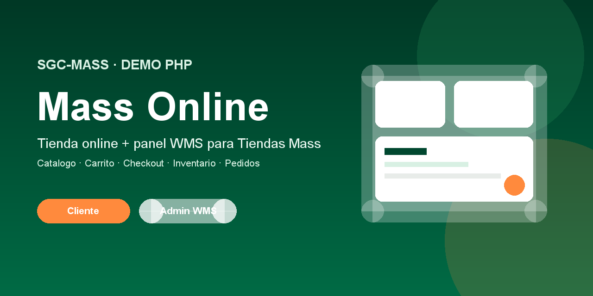
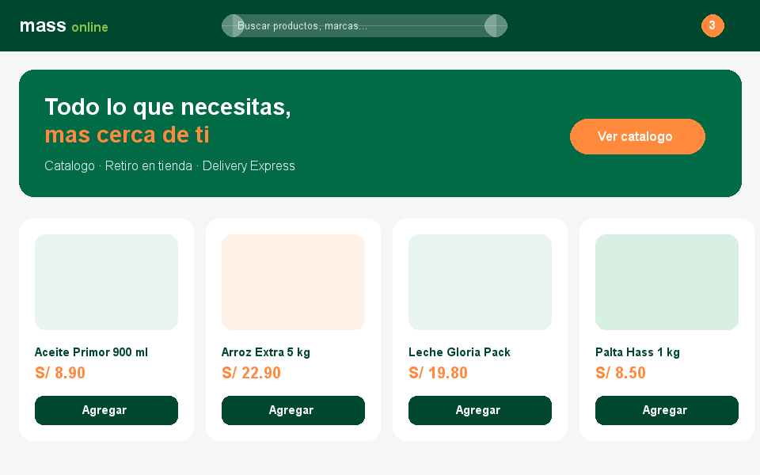
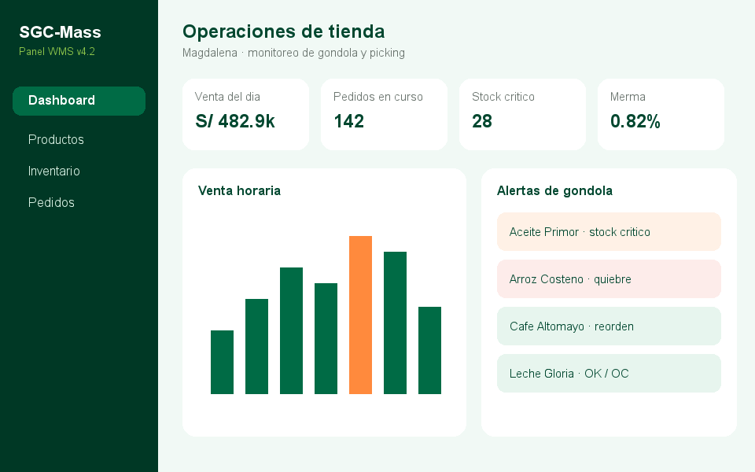

# Mass Online · SGC-Mass



**Demo PHP** de e-commerce y operaciones para *Tiendas Mass*:
catálogo, carrito, checkout (retiro / delivery) y panel admin WMS (inventario, pedidos, productos).


---

## ¿Qué es este proyecto?

**Mass Online** es el portal de compra del cliente (storefront).  
**SGC-Mass** es el panel de control de tienda (WMS / góndola / picking).

Todo corre en **PHP puro** (sin Laravel ni frameworks JS). Por defecto usa datos demo en sesión; opcionalmente puede persistir en **MySQL/MariaDB** vía PDO. Ideal para prácticas de:

- reglas de negocio (retiro vs express, cupones, validación de pedidos)
- calidad de software (PHPUnit + suites CLI en `/tests`)
- UX de checkout y panel operativo

| Módulo | Ruta | Para quién |
|--------|------|------------|
| Tienda online | `cliente_interfaces/` → `frontend/views/cliente/` | Cliente Mass Online |
| Portal proveedor | `proveedor/` → `frontend/views/proveedor/` | Proveedor B2B (OC, SKU, entregas) |
| Panel WMS | `admin/` → `frontend/views/admin/` | Administrador de operaciones |
| Backend | `backend/` | Config, repositorios PDO, middleware |
| Núcleo | `includes/` | Auth, carrito, checkout, fallback demo |
| Pruebas | `tests/` | Validación de reglas |
| Prompts | `PROMTS/` | Prompts versionados del proyecto |

---

## Vistas principales

| Tienda Mass Online | Admin SGC-Mass |
|:---:|:---:|
|  |  |

*Izquierda:* storefront (hero, catálogo, carrito) · *Derecha:* dashboard WMS (KPIs, alertas de góndola)

### Flujo cliente
1. Catálogo y ficha de producto (PDP)
2. Carrito con cupones Club Mass
3. Checkout en 3 pasos: canasta → entrega/retiro → pago
4. Confirmación con tracking (retiro en tienda **o** delivery express)

### Flujo admin
1. Login SGC-Mass (admin WMS / cliente)
2. Dashboard de venta, pedidos y stock crítico
3. Catálogo admin (alta/edición con reglas EAN, margen, ABC)
4. Inventario y cola de picking / pedidos

---

## Requisitos

- **PHP 8.1+** (XAMPP / MAMP / servidor local)
- Extensiones habituales de PHP (`session`, `mbstring`, `pdo_mysql` si usas BD)
- Composer (para PHPUnit)
- Navegador moderno

## Cómo ejecutar

1. Copia el proyecto a tu servidor local, por ejemplo:
   - XAMPP → `htdocs/paginaweb` (o el nombre de carpeta que uses)
2. Abre:
   - **Tienda (cliente):** `http://localhost/<carpeta>/` → `cliente_interfaces/`
   - **Login por rol:** `http://localhost/<carpeta>/admin/login.php` (Admin · Cliente · Proveedor)
   - **Portal proveedor:** tras login Proveedor → `proveedor/`
   - **Admin WMS:** tras login Admin → `admin/`
3. Atajo demo de checkout cliente:  
   `cliente_interfaces/pedido.php?demo=1`

### MySQL opcional (XAMPP)

1. Arranca Apache + MySQL
2. Importa `database/schema.sql` y luego `database/seed.sql`
3. Copia `backend/config/database.example.php` → `backend/config/database.local.php`  
   (deja `"enabled" => true`; ese archivo no se sube a Git)

Sin BD configurada, el sistema sigue funcionando con datos demo en sesión.

---

## Credenciales demo

| Usuario | Contraseña | Rol | Destino |
|---------|------------|-----|---------|
| `admin` · `admin.operaciones@mass.pe` | `123456` | Administrador WMS | `admin/` |
| `cliente` · `cliente@mass.pe` | `123456` | Cliente Mass Online | `cliente_interfaces/` |
| `proveedor` · `proveedor@mass.pe` | `123456` | Proveedor B2B | `proveedor/` |

> Roles **separados**. Solo para demo académica.

## Cupones demo

| Código | Descuento |
|--------|-----------|
| `CLUBMASS10` | S/ 5.00 |
| `CLUBMASS60` | S/ 6.00 |

## Reglas de negocio destacadas

- **Retiro en tienda:** envío gratis; valida stock de la tienda elegida
- **Delivery Express:** + S/ 4.90; exige dirección completa y horarios propios
- **Aprovecha+:** ahorro extra desde 3 unidades en canasta
- **CSRF** en formularios de carrito y login; cookies `HttpOnly` + `SameSite=Lax`
- **Tope** de 99 unidades por línea de carrito

---

## Estructura del repositorio

```text
paginaweb/
├── admin/                  # Shims → frontend/views/admin
├── cliente_interfaces/     # Shims → frontend/views/cliente
├── frontend/               # Vistas + assets (css, js, img)
├── backend/                # PDO, repositorios, servicios, middleware
├── database/               # schema.sql + seed.sql
├── includes/               # init, data demo, functions, layouts legacy
├── assets/                 # Copia legacy de estáticos (la app usa frontend/assets)
├── docs/img/               # Banner y previews del README
├── docs/pruebas/           # Plan QA, evidencias, guía SonarQube
├── PROMTS/                 # Prompts del proyecto (01, 02, 03…)
├── tests/                  # PHPUnit + suites CLI
├── index.php               # Entrada → tienda
├── MEJORAS.md              # Historial de correcciones por rama
└── README.md
```

## Pruebas (calidad de software)

```bash
composer install
composer test
php tests/run_all.php
```

Suites CLI legacy (si existen en la rama):

```bash
php tests/auth_test.php
php tests/negocio_test.php
php tests/productos_admin_test.php
php tests/carrito_test.php
php tests/csrf_test.php
```

Las suites validan autenticación, checkout (retiro/express/cupones), catálogo admin WMS, límites de carrito, logout/cambio de rol y tokens CSRF.

## Mejoras recientes

Detalle completo en [`MEJORAS.md`](MEJORAS.md):

| Rama | Tipo | Resumen |
|------|------|---------|
| `fix/cupones-checkout` | Bug | Cupones Club Mass consistentes (`CLUBMASS10` / `CLUBMASS60`) |
| `fix/carrito-cantidad-maxima` | Bug | Tope 99 unidades en agregar/cambiar |
| `mejora/seguridad-csrf` | Seguridad | CSRF + cookies de sesión endurecidas |
| `docs/readme-proyecto` | Docs | Documentación de arranque |
| `mejora/csrf-admin-productos` | Seguridad | CSRF en productos admin |
| `mejora/session-regenerate-login` | Seguridad | Regenerar sesión al login |
| `mejora/headers-seguridad` | Seguridad | Headers HTTP en Apache |
| `fix/sanitizar-redirect-volver` | Bug | Redirect `volver` seguro |
| `mejora/accesibilidad-carrito-aria` | a11y | ARIA del carrito |
| `mejora/runner-tests-cli` | Calidad | Runner `tests/run_all.php` |
| `correccion/sonar-accesibilidad` | a11y / arch | Sonar labels, FE/BE, MySQL, logout |
| *(más)* | — | Ver [`MEJORAS.md`](MEJORAS.md) |

---

## Stack técnico

- **Backend:** PHP 8 (strict types, sesiones, PDO opcional)
- **Frontend:** HTML semántico, CSS por módulos (`tokens`, `catalogo`, `pedido`, `admin`…)
- **JS:** UI ligera (drawer carrito, qty, countdown)
- **Datos:** demo en `includes/data.php` y/o MySQL (`database/`)

## Autor / contexto

Proyecto académico de **Pruebas y Calidad de Software** — demo funcional de tienda Mass Online y panel SGC-Mass.

---


*Mass Online · SGC-Mass — demo PHP · uso académico*
