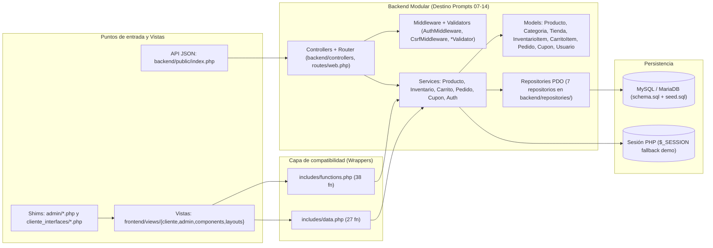

# Auditoría Técnica y Mapa de Dependencias — Mass Online / SGC-Mass (`paginaweb`)

**Intent:** INT-004 | **Bolt:** INT-004-BOLT-001 | **HU:** INT-004-HU-06 | **Modelo IA:** Gemini 4 Argon | **Fecha:** 2026-11-01 | **Responsable:** cursor12310-sys

---

## 1. Introducción

El presente documento constituye el entregable técnico del bolt **`INT-004-BOLT-001`** (**PROMPT 06**), elaborado mediante la inspección estática y verificación empírica del 100 % de los archivos `.php`, `.js` y `.css` del repositorio `paginaweb` (**Mass Online / SGC-Mass**).

Durante la primera iteración de refactorización (commit `55ce88d`, asociado al `PROMPT 02` original), se creó la estructura de carpetas `backend/`, `frontend/` y `database/`, así como los *shims* de compatibilidad en `admin/` y `cliente_interfaces/`. Sin embargo, la extracción quedó incompleta: la lógica de negocio permaneció concentrada en `includes/functions.php` (864 líneas, 27 007 bytes, 38 funciones) e `includes/data.php` (1261 líneas, 45 717 bytes, 27 funciones), quedaron múltiples clases del backend sin consumidores y permanecieron 24 pares de archivos duplicados entre las carpetas heredadas (`assets/`, `includes/`) y las nuevas (`frontend/assets/`, `frontend/views/`).

---

## 2. Objetivo de la auditoría

1. Inventariar y clasificar el **100 % de los archivos `.php`, `.js` y `.css`** pertenecientes a los directorios del proyecto (`admin/`, `cliente_interfaces/`, `frontend/`, `backend/`, `includes/`, `tests/`, `scripts/`, `database/`, `assets/` y raíz).
2. Reconstruir el **grafo exacto de dependencias** (`require`, `require_once`, `include`, `include_once`) línea por línea.
3. Inventariar las **65 funciones globales** (`38` en `includes/functions.php` y `27` en `includes/data.php`), identificando sus consumidores reales y su destino arquitectónico dentro de los 7 módulos de negocio.
4. Detectar con precisión el **código sin consumidores** en `backend/` e `includes/`.
5. Comparar byte a byte los **24 pares de archivos duplicados**, documentando qué mejoras de seguridad y accesibilidad (`INT-002`) quedaron solo en las copias heredadas y deben preservarse antes de cualquier limpieza.
6. Establecer un **plan de migración secuencial y sin regresiones para los prompts 07 al 19**.

---

## 3. Alcance y metodología

- **Directorios auditados:** raíz del proyecto (`index.php`, `logout.php`), `admin/`, `cliente_interfaces/`, `frontend/`, `backend/`, `includes/`, `tests/`, `scripts/`, `database/` y `assets/` (directorio heredado en raíz analizado para comparación de duplicados).
- **Directorios excluidos (con justificación):**
  - `vendor/`: librerías de terceros gestionadas por Composer (PHPUnit 11.5 y dependencias).
  - `.phpunit.cache/` y `.git/`: metadatos internos de herramientas.
  - `docs/pruebas/evidencias/coverage/html/`: reporte HTML estático autogenerado por PCOV/PHPUnit (contiene 5 archivos `.css` y 5 archivos `.js` de Bootstrap/D3/jQuery que no forman parte del código fuente de la aplicación).
- **Metodología:** análisis automatizado de árboles de directorios con `Get-ChildItem`, extracción por expresiones regulares y tokenización de sentencias `require`/`include`, cruce de llamadas a funciones/clases en los 101 archivos PHP del proyecto y comparación de hashes MD5 y diffs línea por línea entre carpetas duplicadas.

---

## 4. Estructura actual del proyecto

```text
paginaweb/
├── index.php                                 # Punto de entrada raíz (redirige a cliente_interfaces/index.php)
├── logout.php                                # Cierre de sesión unificado en raíz
├── .htaccess                                 # Cabeceras HTTP de seguridad (INT-002-BOLT-006)
├── composer.json / phpunit.xml               # Configuración de Composer y PHPUnit 11.5
├── sonar-project.properties                  # Configuración de SonarQube (Pagina_Web_V2)
├── admin/                                    # 6 shims PHP (~145 B c/u) que delegan a frontend/views/admin/
├── cliente_interfaces/                       # 7 shims PHP (~148 B c/u) que delegan a frontend/views/cliente/
├── assets/                                   # [HEREDADO] 8 CSS y 3 JS (algunos con fixes de INT-002 no copiados a frontend/)
├── includes/                                 # Núcleo actual: init.php, functions.php (38 fn), data.php (27 fn)
│   ├── admin/                                # [HEREDADO] 3 parciales admin sin consumidores activos
│   ├── components/                           # 8 componentes (3 aún requeridos por functions.php; 5 sin uso directo)
│   └── layouts/                              # [HEREDADO] 2 layouts sin consumidores activos (contienen mejoras INT-002)
├── backend/                                  # Capa backend en transición (20 archivos PHP)
│   ├── bootstrap.php                         # Inicializador que carga Database, Middleware y 6 Repositories
│   ├── Database.php                          # Gestor PDO MySQL/MariaDB
│   ├── config/                               # app.php, database.example.php, database.local.php
│   ├── controllers/                          # AuthController.php (stub sin consumidores)
│   ├── middleware/                           # AuthMiddleware.php, CsrfMiddleware.php (sin consumidores)
│   ├── public/                               # index.php (endpoint JSON de diagnóstico de salud)
│   ├── repositories/                         # 7 repositorios PDO (6 activos desde includes/, 1 sin uso: InventarioRepository)
│   ├── routes/                               # web.php (mapa declarativo sin router consumidor)
│   ├── services/                             # AuthService.php (stub sin consumidores)
│   └── validators/                           # PedidoValidator.php, ProductoValidator.php (stubs sin consumidores)
├── frontend/                                 # Capa de presentación activa
│   ├── assets/                               # 8 CSS, 3 JS y SVG servidos vía mass_asset()
│   └── views/                                # 26 archivos PHP (admin/, cliente/, components/, layouts/)
├── database/                                 # schema.sql (9 tablas) y seed.sql (datos iniciales)
├── scripts/                                  # 3 scripts PHP (generate_seed, smoke_views, smoke_auth_logout) y 2 .bat Sonar
└── tests/                                    # 21 archivos PHP (bootstrap, TestCase, SqliteLabStore, run_all, 6 CLI, 4 Unit, 7 Feature)
```

> **Hallazgo estructural clave:** La carpeta `backend/models/` solicitada en la arquitectura objetivo **no existe todavía** (se creará en los Prompts 07 a 11).

---

## 5. Clasificación de archivos (100 % del alcance: 123 archivos `.php`, `.js` y `.css`)

Resumen cuantitativo del inventario:
- **Archivos PHP (`.php`):** `101`
- **Archivos JavaScript (`.js`):** `6` (`3` en `frontend/assets/js/` + `3` en `assets/js/`)
- **Archivos CSS (`.css`):** `16` (`8` en `frontend/assets/css/` + `8` en `assets/css/`)
- **Total de archivos de código auditados:** **`123`** (100 % clasificados en la tabla siguiente).

*(Además, en `database/` existen 2 archivos SQL: `database/schema.sql` [Acceso a datos / DDL de 9 tablas] y `database/seed.sql` [Acceso a datos / DML inicial]; y en `scripts/` existen 2 scripts por lotes: `scripts/prepare-sonar.bat` y `scripts/scan-sonar.bat` [Configuración / Calidad]).*

| # | Ruta relativa | Tipo | Categoría | Responsabilidad principal | Módulo | Dependencias principales | Estado de uso |
| :---: | :--- | :---: | :--- | :--- | :--- | :--- | :--- |
| 1 | `index.php` | PHP | **Control de solicitudes** | Punto de entrada raíz que redirige a cliente_interfaces/index.php | Rutas / Tienda | Ninguna (header Location directo) | Utilizado (punto de entrada raíz) |
| 2 | `logout.php` | PHP | **Control de solicitudes** | Endpoint unificado de cierre de sesión (redirige según rol admin/cliente) | Autenticación | includes/init.php | Utilizado (punto de entrada de logout) |
| 3 | `admin/index.php` | PHP | **Control de solicitudes** | Shim de compatibilidad URL hacia el dashboard administrativo | Admin / Dashboard | includes/init.php, frontend/views/admin/index.php | Utilizado (punto de entrada URL /admin/index.php) |
| 4 | `admin/inventario.php` | PHP | **Control de solicitudes** | Shim de compatibilidad URL hacia la vista de inventario/góndolas WMS | Inventario | includes/init.php, frontend/views/admin/inventario.php | Utilizado (punto de entrada URL /admin/inventario.php) |
| 5 | `admin/login.php` | PHP | **Control de solicitudes** | Shim de compatibilidad URL hacia el formulario y proceso de login SGC | Autenticación | includes/init.php, frontend/views/admin/login.php | Utilizado (punto de entrada URL /admin/login.php) |
| 6 | `admin/logout.php` | PHP | **Control de solicitudes** | Shim de compatibilidad URL hacia el cierre de sesión desde /admin/ | Autenticación | includes/init.php, frontend/views/admin/logout.php | Utilizado (shim secundario de logout admin) |
| 7 | `admin/pedidos.php` | PHP | **Control de solicitudes** | Shim de compatibilidad URL hacia el listado y filtro de pedidos admin | Pedidos | includes/init.php, frontend/views/admin/pedidos.php | Utilizado (punto de entrada URL /admin/pedidos.php) |
| 8 | `admin/productos.php` | PHP | **Control de solicitudes** | Shim de compatibilidad URL hacia el ABM de productos WMS | Productos | includes/init.php, frontend/views/admin/productos.php | Utilizado (punto de entrada URL /admin/productos.php) |
| 9 | `cliente_interfaces/carrito.php` | PHP | **Control de solicitudes** | Shim de compatibilidad URL hacia el controlador POST de acciones del carrito/cupón/entrega | Carrito / Pedidos | includes/init.php, frontend/views/cliente/carrito.php | Utilizado (endpoint POST /cliente_interfaces/carrito.php) |
| 10 | `cliente_interfaces/catalogo.php` | PHP | **Control de solicitudes** | Shim de compatibilidad URL hacia la vista de catálogo y filtros | Productos / Catálogo | includes/init.php, frontend/views/cliente/catalogo.php | Utilizado (punto de entrada URL /cliente_interfaces/catalogo.php) |
| 11 | `cliente_interfaces/confirmacion.php` | PHP | **Control de solicitudes** | Shim de compatibilidad URL hacia confirmación y tracking de pedido | Pedidos | includes/init.php, frontend/views/cliente/confirmacion.php | Utilizado (punto de entrada URL /cliente_interfaces/confirmacion.php) |
| 12 | `cliente_interfaces/index.php` | PHP | **Control de solicitudes** | Shim de compatibilidad URL hacia la portada de la tienda (home) | Tienda / Catálogo | includes/init.php, frontend/views/cliente/index.php | Utilizado (punto de entrada URL /cliente_interfaces/index.php) |
| 13 | `cliente_interfaces/logout.php` | PHP | **Control de solicitudes** | Shim de compatibilidad URL hacia el cierre de sesión desde tienda | Autenticación | includes/init.php, frontend/views/cliente/logout.php | Utilizado (shim secundario de logout cliente) |
| 14 | `cliente_interfaces/pedido.php` | PHP | **Control de solicitudes** | Shim de compatibilidad URL hacia el checkout y resumen de pedido | Pedidos / Carrito | includes/init.php, frontend/views/cliente/pedido.php | Utilizado (punto de entrada URL /cliente_interfaces/pedido.php) |
| 15 | `cliente_interfaces/producto.php` | PHP | **Control de solicitudes** | Shim de compatibilidad URL hacia la ficha de detalle de producto (PDP) | Productos / Inventario | includes/init.php, frontend/views/cliente/producto.php | Utilizado (punto de entrada URL /cliente_interfaces/producto.php) |
| 16 | `includes/init.php` | PHP | **Configuración** | Bootstrap clásico de sesión, cookie HttpOnly/SameSite, MASS_BASE_HREF y carga de backend/data/functions | Utilidades / Configuración | backend/bootstrap.php, includes/data.php, includes/functions.php | Utilizado (núcleo requerido por todas las páginas y smoke tests) |
| 17 | `includes/functions.php` | PHP | **Lógica de negocio** | Concentrador de 37 funciones de carrito, pedidos, cupones, auth, CSRF, rutas, filtros y helpers de vista | Todos los módulos (7) | includes/components/{product-card,category-card,store-card}.php, CuponRepository, PedidoRepository, UsuarioRepository | Utilizado (dependencia central de todo el sistema) |
| 18 | `includes/data.php` | PHP | **Lógica de negocio** | Concentrador de 23 funciones de catálogo, tiendas, KPIs admin, ABM productos y datos semilla demo (con fallback desde Repositories) | Productos, Inventario, Pedidos, Utilidades | CategoriaRepository, ProductoRepository, TiendaRepository, Database | Utilizado (dependencia central de datos y lógica admin) |
| 19 | `includes/admin/header.php` | PHP | **Duplicado** | Copia heredada del encabezado del panel admin (con rutas ../assets/ sin mass_asset) | Admin | includes/admin/sidebar.php | Aparentemente sin consumidores (reemplazado por frontend/views/admin/partials/header.php) |
| 20 | `includes/admin/sidebar.php` | PHP | **Duplicado** | Copia heredada de la barra lateral del panel admin | Admin | mass_admin_usuario(), mass_admin_kpis(), mass_admin_picking_cola() | Aparentemente sin consumidores (solo requerido por includes/admin/header.php) |
| 21 | `includes/admin/footer.php` | PHP | **Duplicado** | Copia heredada del pie de página admin | Admin | Ninguna | Aparentemente sin consumidores (reemplazado por frontend/views/admin/partials/footer.php) |
| 22 | `includes/layouts/header.php` | PHP | **Duplicado** | Copia heredada del header de tienda (conserva <meta name="theme-color"> del INT-002-BOLT-010) | Utilidades / Layout | includes/components/topbar.php, includes/components/navbar.php | Aparentemente sin consumidores (pero contiene meta theme-color que falta en frontend/views/layouts/header.php) |
| 23 | `includes/layouts/footer.php` | PHP | **Duplicado** | Copia heredada del footer de tienda (conserva aria-live="polite" en #toast del INT-002-BOLT-011) | Utilidades / Layout | includes/components/cart-drawer.php | Aparentemente sin consumidores (pero contiene aria-live que falta en frontend/views/layouts/footer.php) |
| 24 | `includes/components/cart-drawer.php` | PHP | **Duplicado** | Copia heredada del drawer del carrito (conserva role="dialog", aria-modal y csrf_field() que faltan en frontend/) | Carrito | carrito_items(), producto_por_id(), csrf_field() | Aparentemente sin consumidores (solo requerido por includes/layouts/footer.php; fusionar mejoras antes de retirar) |
| 25 | `includes/components/cart-line.php` | PHP | **Duplicado** | Copia heredada de línea del carrito en checkout | Carrito | csrf_field(), dinero(), e() | Aparentemente sin consumidores (reemplazado por frontend/views/components/cart-line.php) |
| 26 | `includes/components/category-card.php` | PHP | **Vista** | Componente de tarjeta de categoría invocado por render_category_card() | Productos / Catálogo | e() | Utilizado (requerido activamente por includes/functions.php:839) |
| 27 | `includes/components/navbar.php` | PHP | **Duplicado** | Copia heredada de barra de navegación (conserva atributos ARIA en #openCart del INT-002-BOLT-007) | Utilidades / Navegación | auth_usuario(), carrito_total_unidades(), mass_url(), mass_asset() | Aparentemente sin consumidores (solo requerido por includes/layouts/header.php; fusionar ARIA antes de retirar) |
| 28 | `includes/components/order-summary-side.php` | PHP | **Duplicado** | Copia heredada del resumen lateral de pedido | Pedidos | pedido_resumen(), dinero() | Aparentemente sin consumidores (reemplazado por frontend/views/components/order-summary-side.php) |
| 29 | `includes/components/product-card.php` | PHP | **Vista** | Componente de tarjeta de producto invocado por render_product_card() (contiene csrf_field()) | Productos / Carrito | csrf_field(), dinero(), e() | Utilizado (requerido activamente por includes/functions.php:834) |
| 30 | `includes/components/store-card.php` | PHP | **Vista** | Componente de tarjeta de tienda invocado por render_store_card() | Inventario / Tiendas | e() | Utilizado (requerido activamente por includes/functions.php:844) |
| 31 | `includes/components/topbar.php` | PHP | **Duplicado** | Copia heredada de barra superior informativa | Utilidades / Layout | Ninguna | Aparentemente sin consumidores (solo requerido por includes/layouts/header.php) |
| 32 | `backend/bootstrap.php` | PHP | **Configuración** | Inicializador del backend: define MASS_ROOT y carga Database, Middleware y 6 de los 7 Repositories | Configuración / Backend | Database.php, CsrfMiddleware, AuthMiddleware, 6 Repositories | Utilizado (requerido por includes/init.php y backend/public/index.php) |
| 33 | `backend/Database.php` | PHP | **Acceso a datos** | Singleton PDO para conexión MySQL/MariaDB con control de errores y flag MASS_USE_DB | Configuración / Base de datos | backend/config/database.local.php, backend/config/database.example.php | Utilizado (consumido por Repositories e includes/) |
| 34 | `backend/config/app.php` | PHP | **Configuración** | Arreglo de metadatos de aplicación (name, version, timezone) | Configuración | Ninguna | Aparentemente sin consumidores (ningún archivo le hace require) |
| 35 | `backend/config/database.example.php` | PHP | **Configuración** | Plantilla de configuración de conexión PDO MySQL (host, port, dbname, user, pass) | Configuración / Base de datos | Variables de entorno opcionales | Utilizado (cargado por backend/Database.php como fallback) |
| 36 | `backend/config/database.local.php` | PHP | **Configuración** | Configuración local de conexión PDO MySQL (ignorado en Git) | Configuración / Base de datos | Variables de entorno opcionales | Utilizado (cargado prioritariamente por backend/Database.php) |
| 37 | `backend/controllers/AuthController.php` | PHP | **Control de solicitudes** | Controlador stub con un único método loginForm() que incluye la vista de login | Autenticación | frontend/views/admin/login.php | Aparentemente sin consumidores (no requerido ni instanciado en el proyecto) |
| 38 | `backend/middleware/AuthMiddleware.php` | PHP | **Control de solicitudes** | Middleware estático con requireAdmin() y requireCliente() | Autenticación / Seguridad | auth_es_admin(), auth_es_cliente(), redirect() | Aparentemente sin consumidores (cargado en bootstrap.php pero nunca invocado) |
| 39 | `backend/middleware/CsrfMiddleware.php` | PHP | **Control de solicitudes** | Middleware estático alternativo de CSRF (usa $_SESSION['_csrf'] en vez de $_SESSION['csrf_token']) | Seguridad | Ninguna | Aparentemente sin consumidores (cargado en bootstrap.php pero nunca invocado; duplica funciones de includes/functions.php) |
| 40 | `backend/public/index.php` | PHP | **Control de solicitudes** | Endpoint JSON de diagnóstico de salud de la aplicación y estado de conexión MySQL | Utilidades / API | backend/bootstrap.php, Database | Utilizado (endpoint público /backend/public/index.php) |
| 41 | `backend/repositories/CategoriaRepository.php` | PHP | **Acceso a datos** | Repositorio PDO para consulta de categorías activas (tabla categorias) | Productos / Catálogo | PDO (Database::get()) | Utilizado (consumido por includes/data.php en mass_categorias()) |
| 42 | `backend/repositories/CuponRepository.php` | PHP | **Acceso a datos** | Repositorio PDO para consulta de cupones activos (tabla cupones) | Cupones | PDO (Database::get()) | Utilizado (consumido por includes/functions.php en pedido_cupones_validos()) |
| 43 | `backend/repositories/InventarioRepository.php` | PHP | **Acceso a datos** | Repositorio PDO para consulta y actualización de inventario por tienda (tabla inventario) | Inventario | PDO (Database::get()) | Aparentemente sin consumidores (no está en backend/bootstrap.php ni se invoca en ningún archivo) |
| 44 | `backend/repositories/PedidoRepository.php` | PHP | **Acceso a datos** | Repositorio PDO transaccional para crear y listar pedidos y sus detalles (tablas pedidos, pedido_detalles) | Pedidos | PDO (Database::get()) | Utilizado (consumido por includes/functions.php y MysqlDisponibilidadTest) |
| 45 | `backend/repositories/ProductoRepository.php` | PHP | **Acceso a datos** | Repositorio PDO para catálogo, detalle, listado WMS, creación y edición de productos (tabla productos) | Productos | PDO (Database::get()) | Utilizado (consumido por includes/data.php y MysqlDisponibilidadTest) |
| 46 | `backend/repositories/TiendaRepository.php` | PHP | **Acceso a datos** | Repositorio PDO para listar y buscar tiendas con su stock agregado (tablas tiendas, inventario) | Inventario / Tiendas | PDO (Database::get()) | Utilizado (consumido por includes/data.php en mass_tiendas() y mass_tienda_por_id()) |
| 47 | `backend/repositories/UsuarioRepository.php` | PHP | **Acceso a datos** | Repositorio PDO para listar usuarios activos con su rol (tablas usuarios, roles) | Autenticación | PDO (Database::get()) | Utilizado (consumido por includes/functions.php en mass_usuarios_auth()) |
| 48 | `backend/routes/web.php` | PHP | **Configuración** | Mapa asociativo de nombres de ruta lógicos a rutas de vistas en frontend/views/ | Rutas | Ninguna | Aparentemente sin consumidores (mapa declarativo sin router que lo cargue) |
| 49 | `backend/services/AuthService.php` | PHP | **Lógica de negocio** | Servicio stub que delega attempt(), login() y logout() a las funciones globales de includes/functions.php | Autenticación | auth_intentar(), auth_login(), auth_logout() | Aparentemente sin consumidores (no requerido ni instanciado en ningún archivo) |
| 50 | `backend/validators/PedidoValidator.php` | PHP | **Lógica de negocio** | Validador stub que delega validateEntrega() a pedido_validar_entrega() | Pedidos | pedido_validar_entrega() | Aparentemente sin consumidores (no requerido en bootstrap.php ni instanciado) |
| 51 | `backend/validators/ProductoValidator.php` | PHP | **Lógica de negocio** | Validador stub que delega validate() a producto_admin_validar() | Productos | producto_admin_validar() | Aparentemente sin consumidores (no requerido en bootstrap.php ni instanciado) |
| 52 | `frontend/views/admin/index.php` | PHP | **Vista** | Vista del dashboard administrativo WMS (KPIs, venta horaria, canales, ABC, alertas de góndola) | Admin / Dashboard | auth_requerir_admin(), mass_admin_*, frontend/views/admin/partials/{header,footer}.php | Utilizado (incluido por admin/index.php) |
| 53 | `frontend/views/admin/inventario.php` | PHP | **Vista** | Vista de control de inventario y góndolas WMS con filtro por categoría y estado | Inventario | auth_requerir_admin(), mass_admin_gondola(), frontend/views/admin/partials/{header,footer}.php | Utilizado (incluido por admin/inventario.php) |
| 54 | `frontend/views/admin/login.php` | PHP | **Vista** | Vista y controlador POST/GET de inicio de sesión y cambio de rol (admin/cliente) | Autenticación | auth_intentar(), auth_login(), auth_logout(), csrf_validar(), mass_asset() | Utilizado (incluido por admin/login.php) |
| 55 | `frontend/views/admin/logout.php` | PHP | **Control de solicitudes** | Controlador de cierre de sesión administrativo (redirige a login.php) | Autenticación | auth_logout(), flash_set(), redirect() | Utilizado (incluido por admin/logout.php) |
| 56 | `frontend/views/admin/partials/header.php` | PHP | **Vista** | Encabezado del layout administrativo con buscador #adminSearchQ y carga de sidebar | Admin / Layout | mass_admin_usuario(), mass_asset(), frontend/views/admin/partials/sidebar.php | Utilizado (requerido por las 4 vistas internas de admin) |
| 57 | `frontend/views/admin/partials/sidebar.php` | PHP | **Vista** | Barra lateral de navegación del panel administrativo WMS | Admin / Layout | mass_admin_usuario(), mass_admin_kpis(), mass_admin_picking_cola(), mass_asset() | Utilizado (requerido por frontend/views/admin/partials/header.php) |
| 58 | `frontend/views/admin/partials/footer.php` | PHP | **Vista** | Pie de página administrativo y carga de frontend/assets/js/admin.js | Admin / Layout | mass_asset() | Utilizado (requerido por las 4 vistas internas de admin) |
| 59 | `frontend/views/admin/pedidos.php` | PHP | **Vista** | Vista de listado y filtrado de pedidos en el panel administrativo (modo y código) | Pedidos / Admin | auth_requerir_admin(), mass_admin_pedidos(), frontend/views/admin/partials/{header,footer}.php | Utilizado (incluido por admin/pedidos.php) |
| 60 | `frontend/views/admin/productos.php` | PHP | **Vista** | Vista y controlador POST de alta y edición de productos WMS con validación y CSRF | Productos / Admin | auth_requerir_admin(), csrf_validar(), mass_admin_productos(), mass_admin_producto_crear/guardar() | Utilizado (incluido por admin/productos.php) |
| 61 | `frontend/views/cliente/carrito.php` | PHP | **Control de solicitudes** | Controlador POST de acciones de carrito (agregar, cambiar, eliminar, vaciar, cupón, entrega) | Carrito / Pedidos | csrf_validar(), carrito_*, pedido_*, mass_safe_return_url(), redirect() | Utilizado (incluido por cliente_interfaces/carrito.php) |
| 62 | `frontend/views/cliente/catalogo.php` | PHP | **Vista** | Vista de catálogo de productos con filtros laterales, búsqueda, ordenamiento y empty state | Productos / Catálogo | filtrar_productos(), mass_filtros_catalogo(), render_product_card(), frontend/views/layouts/{header,footer}.php | Utilizado (incluido por cliente_interfaces/catalogo.php) |
| 63 | `frontend/views/cliente/confirmacion.php` | PHP | **Vista** | Vista y controlador POST de confirmación de pedido y seguimiento (tracking) | Pedidos | pedido_confirmar(), pedido_ultimo(), pedido_tracking_pasos(), frontend/views/layouts/{header,footer}.php | Utilizado (incluido por cliente_interfaces/confirmacion.php) |
| 64 | `frontend/views/cliente/index.php` | PHP | **Vista** | Vista principal (home) de la tienda online con banners, categorías y productos destacados | Tienda / Catálogo | mass_categorias(), mass_productos(), render_category_card(), render_product_card(), frontend/views/layouts/{header,footer}.php | Utilizado (incluido por cliente_interfaces/index.php y scripts/smoke_views.php) |
| 65 | `frontend/views/cliente/logout.php` | PHP | **Control de solicitudes** | Controlador de cierre de sesión desde cliente_interfaces/ | Autenticación | auth_es_admin(), auth_logout(), flash_set(), redirect() | Utilizado (incluido por cliente_interfaces/logout.php) |
| 66 | `frontend/views/cliente/pedido.php` | PHP | **Vista** | Vista de checkout (selección retiro/express, tienda, dirección, cupón y líneas del carrito) | Pedidos / Carrito | carrito_items(), pedido_estado(), pedido_resumen(), mass_tiendas(), frontend/views/components/{cart-line,order-summary-side}.php | Utilizado (incluido por cliente_interfaces/pedido.php) |
| 67 | `frontend/views/cliente/producto.php` | PHP | **Vista** | Vista de ficha de detalle de producto (PDP), stock por tienda y productos relacionados | Productos / Inventario | mass_producto_detalle(), mass_tiendas(), productos_por_ids(), render_store_card(), render_product_card() | Utilizado (incluido por cliente_interfaces/producto.php) |
| 68 | `frontend/views/components/cart-drawer.php` | PHP | **Vista** | Componente de drawer lateral del carrito (le faltan csrf_field() y role="dialog" que sí están en includes/components/cart-drawer.php) | Carrito | carrito_items(), carrito_total_monto(), producto_por_id(), dinero() | Utilizado (requerido por frontend/views/layouts/footer.php) |
| 69 | `frontend/views/components/cart-line.php` | PHP | **Vista** | Componente de fila de producto en el carrito/checkout con $cartCheckId único por línea | Carrito | csrf_field(), dinero(), e() | Utilizado (requerido por frontend/views/cliente/pedido.php) |
| 70 | `frontend/views/components/category-card.php` | PHP | **Duplicado** | Copia en frontend/ de la tarjeta de categoría (aún no conectada porque render_category_card() requiere includes/components/) | Productos / Catálogo | e() | Aparentemente sin consumidores (pendiente de conectar en render_category_card()) |
| 71 | `frontend/views/components/navbar.php` | PHP | **Vista** | Barra de navegación principal de la tienda con menú de cuenta, buscador y acceso al carrito | Utilidades / Navegación | auth_usuario(), carrito_total_unidades(), carrito_total_monto(), mass_url(), mass_asset() | Utilizado (requerido por frontend/views/layouts/header.php) |
| 72 | `frontend/views/components/order-summary-side.php` | PHP | **Vista** | Componente lateral de resumen de importes del pedido (subtotal, descuentos, envío, total) | Pedidos | pedido_resumen(), dinero(), e() | Utilizado (requerido por frontend/views/cliente/pedido.php) |
| 73 | `frontend/views/components/product-card.php` | PHP | **Duplicado** | Copia en frontend/ de la tarjeta de producto (le falta csrf_field() y aún no es requerida por render_product_card()) | Productos / Carrito | dinero(), e() | Aparentemente sin consumidores (pendiente de sincronizar csrf_field() y conectar en render_product_card()) |
| 74 | `frontend/views/components/store-card.php` | PHP | **Duplicado** | Copia en frontend/ de la tarjeta de tienda (aún no es requerida por render_store_card()) | Inventario / Tiendas | e() | Aparentemente sin consumidores (pendiente de conectar en render_store_card()) |
| 75 | `frontend/views/components/topbar.php` | PHP | **Vista** | Barra superior informativa de la tienda (envío express, horarios, Club Mass) | Utilidades / Layout | Ninguna | Utilizado (requerido por frontend/views/layouts/header.php) |
| 76 | `frontend/views/layouts/header.php` | PHP | **Vista** | Encabezado HTML común de las vistas de tienda (carga CSS con mass_asset() e incluye topbar y navbar) | Utilidades / Layout | mass_asset(), frontend/views/components/{topbar,navbar}.php | Utilizado (requerido por las 5 vistas de tienda en frontend/views/cliente/) |
| 77 | `frontend/views/layouts/footer.php` | PHP | **Vista** | Pie de página común de las vistas de tienda (incluye cart-drawer, toast y carga ui.js) | Utilidades / Layout | mass_asset(), frontend/views/components/cart-drawer.php | Utilizado (requerido por las 5 vistas de tienda en frontend/views/cliente/) |
| 78 | `scripts/generate_seed.php` | PHP | **Acceso a datos** | Script CLI generador de database/seed.sql a partir de los catálogos y datos demo de includes/ | Base de datos / Utilidades | includes/data.php, includes/functions.php | Utilizado (herramienta CLI de generación de seed.sql) |
| 79 | `scripts/smoke_auth_logout.php` | PHP | **Control de solicitudes** | Script CLI de prueba de humo de autenticación, logout y cambio de rol (Escenarios A, B y C) | Autenticación / QA | includes/init.php | Utilizado (verificación CLI automatizada) |
| 80 | `scripts/smoke_views.php` | PHP | **Control de solicitudes** | Script CLI de prueba de humo de renderizado de la vista principal y resolución de assets | Tienda / QA | includes/init.php, frontend/views/cliente/index.php | Utilizado (verificación CLI automatizada) |
| 81 | `tests/bootstrap.php` | PHP | **Configuración** | Bootstrap de PHPUnit que aísla $_SESSION y carga vendor/autoload.php | Calidad / QA | vendor/autoload.php | Utilizado (configurado en phpunit.xml) |
| 82 | `tests/TestCase.php` | PHP | **Configuración** | Clase base de pruebas PHPUnit que reinicia $_SESSION antes de cada test | Calidad / QA | PHPUnit\Framework\TestCase, pedido_defaults() | Utilizado (heredado por los 10 tests Unit y Feature) |
| 83 | `tests/Support/SqliteLabStore.php` | PHP | **Acceso a datos** | Almacén SQLite en memoria (:memory:) para laboratorio de pruebas de integración aisladas (P32) | Calidad / QA | PDO (sqlite::memory:) | Utilizado (consumido por CatalogoYSqliteLabTest) |
| 84 | `tests/run_all.php` | PHP | **Control de solicitudes** | Runner CLI que ejecuta secuencialmente PHPUnit y las 6 suites CLI | Calidad / QA | PHPUnit y tests/*_test.php | Utilizado (comando php tests/run_all.php) |
| 85 | `tests/auth_test.php` | PHP | **Lógica de negocio** | Suite CLI de pruebas de autenticación, roles y regeneración de sesión (16 aserciones) | Autenticación / QA | includes/data.php, includes/functions.php | Utilizado (ejecutado por tests/run_all.php) |
| 86 | `tests/carrito_test.php` | PHP | **Lógica de negocio** | Suite CLI de pruebas de operaciones del carrito y tope de 99 unidades (12 aserciones) | Carrito / QA | includes/data.php, includes/functions.php | Utilizado (ejecutado por tests/run_all.php) |
| 87 | `tests/csrf_test.php` | PHP | **Lógica de negocio** | Suite CLI de pruebas de generación y validación de tokens CSRF (9 aserciones) | Seguridad / QA | includes/data.php, includes/functions.php | Utilizado (ejecutado por tests/run_all.php) |
| 88 | `tests/negocio_test.php` | PHP | **Lógica de negocio** | Suite CLI de reglas de negocio de pedidos, envíos, cupones y confirmación (38 aserciones) | Pedidos / Cupones / QA | includes/data.php, includes/functions.php | Utilizado (ejecutado por tests/run_all.php) |
| 89 | `tests/productos_admin_test.php` | PHP | **Lógica de negocio** | Suite CLI de validación y ABM de productos en el panel administrativo (22 aserciones) | Productos / QA | includes/init.php | Utilizado (ejecutado por tests/run_all.php) |
| 90 | `tests/redirect_test.php` | PHP | **Lógica de negocio** | Suite CLI de sanitización de URL de retorno mass_safe_return_url() (6 aserciones) | Seguridad / QA | includes/data.php, includes/functions.php | Utilizado (ejecutado por tests/run_all.php) |
| 91 | `tests/Unit/AuthReglasTest.php` | PHP | **Lógica de negocio** | Pruebas unitarias PHPUnit de reglas de autenticación (casos P11 a P15) | Autenticación / QA | Tests\TestCase, auth_intentar(), auth_login() | Utilizado (suite Unit de PHPUnit) |
| 92 | `tests/Unit/DineroYFormatoTest.php` | PHP | **Lógica de negocio** | Pruebas unitarias PHPUnit de formato monetario dinero() y escape XSS e() (casos P01 y P02) | Utilidades / QA | Tests\TestCase, dinero(), e() | Utilizado (suite Unit de PHPUnit) |
| 93 | `tests/Unit/PedidoReglasTest.php` | PHP | **Lógica de negocio** | Pruebas unitarias PHPUnit de reglas de pedido, envío, cupones y tracking (casos P03 a P10) | Pedidos / Cupones / QA | Tests\TestCase, pedido_*() | Utilizado (suite Unit de PHPUnit) |
| 94 | `tests/Unit/ProductoAdminValidacionTest.php` | PHP | **Lógica de negocio** | Pruebas unitarias PHPUnit de validación de alta/edición de productos WMS (casos P16 a P20) | Productos / QA | Tests\TestCase, producto_admin_validar() | Utilizado (suite Unit de PHPUnit) |
| 95 | `tests/Feature/AuthLogoutCambioRolTest.php` | PHP | **Lógica de negocio** | Pruebas Feature PHPUnit de rutas mass_url/mass_asset, logout y cambio de rol (Escenarios A, B y C) | Autenticación / QA | Tests\TestCase, auth_*(), mass_url(), mass_asset() | Utilizado (suite Feature de PHPUnit) |
| 96 | `tests/Feature/AuthSesionTest.php` | PHP | **Lógica de negocio** | Pruebas Feature PHPUnit de persistencia de login en sesión y estado anónimo (casos P24 y P25) | Autenticación / QA | Tests\TestCase, auth_*() | Utilizado (suite Feature de PHPUnit) |
| 97 | `tests/Feature/CarritoSesionTest.php` | PHP | **Lógica de negocio** | Pruebas Feature PHPUnit de persistencia del carrito en sesión (casos P21 a P23) | Carrito / QA | Tests\TestCase, carrito_*() | Utilizado (suite Feature de PHPUnit) |
| 98 | `tests/Feature/CatalogoYSqliteLabTest.php` | PHP | **Lógica de negocio** | Pruebas Feature PHPUnit de filtrado de catálogo y laboratorio SQLite en memoria (casos P31 y P32) | Productos / QA | Tests\TestCase, filtrar_productos(), SqliteLabStore | Utilizado (suite Feature de PHPUnit) |
| 99 | `tests/Feature/MysqlDisponibilidadTest.php` | PHP | **Acceso a datos** | Prueba Feature PHPUnit de persistencia de pedido en MySQL cuando existe conexión activa | Pedidos / Base de datos / QA | Tests\TestCase, Database, ProductoRepository, PedidoRepository | Utilizado (suite Feature de PHPUnit; se omite con markTestSkipped si MASS_USE_DB=0) |
| 100 | `tests/Feature/PedidoConfirmacionTest.php` | PHP | **Lógica de negocio** | Pruebas Feature PHPUnit de confirmación de pedido express y retiro (casos P26 y P27) | Pedidos / QA | Tests\TestCase, pedido_confirmar() | Utilizado (suite Feature de PHPUnit) |
| 101 | `tests/Feature/ProductoAdminPersistenciaTest.php` | PHP | **Lógica de negocio** | Pruebas Feature PHPUnit de creación y edición de productos admin en sesión (casos P28 a P30) | Productos / QA | Tests\TestCase, mass_admin_producto_crear/guardar() | Utilizado (suite Feature de PHPUnit) |
| 102 | `frontend/assets/js/admin.js` | JS | **Vista** | Lógica interactiva del panel administrativo (filtros, modales, cálculo de margen PVP/costo con Number.parseFloat/parseInt) | Admin / Productos / Inventario | DOM de vistas admin | Utilizado (cargado por frontend/views/admin/partials/footer.php vía mass_asset) |
| 103 | `frontend/assets/js/admin-login.js` | JS | **Vista** | Interacción del formulario de login (cambio de pestaña de rol y mostrar/ocultar contraseña) | Autenticación | DOM de frontend/views/admin/login.php | Utilizado (cargado por frontend/views/admin/login.php vía mass_asset) |
| 104 | `frontend/assets/js/ui.js` | JS | **Vista** | Interacción de la tienda (apertura/cierre de drawer de carrito, menú de cuenta, galería PDP, tabs de checkout) | Tienda / Carrito / Pedidos | DOM de vistas cliente | Utilizado (cargado por frontend/views/layouts/footer.php vía mass_asset; le falta foco accesible presente en assets/js/ui.js) |
| 105 | `assets/js/admin.js` | JS | **Duplicado** | Copia heredada idéntica de frontend/assets/js/admin.js (analizada actualmente por sonar-project.properties) | Admin | DOM de vistas admin | Aparentemente sin consumidores en vistas activas (pero referenciado por sonar.sources) |
| 106 | `assets/js/admin-login.js` | JS | **Duplicado** | Copia heredada idéntica de frontend/assets/js/admin-login.js | Autenticación | DOM de login | Aparentemente sin consumidores (reemplazado por frontend/assets/js/admin-login.js) |
| 107 | `assets/js/ui.js` | JS | **Duplicado** | Copia heredada de ui.js (contiene gestión de aria-hidden y foco closeCart?.focus() del INT-002-BOLT-007 que falta en frontend/assets/js/ui.js) | Tienda / Carrito | DOM de tienda | Aparentemente sin consumidores en vistas activas (fusionar mejoras ARIA hacia frontend/assets/js/ui.js antes de retirar) |
| 108 | `frontend/assets/css/admin.css` | CSS | **Vista** | Hoja de estilos del panel administrativo WMS (incluye +1616 B adicionales respecto a assets/css/admin.css) | Admin | tokens.css | Utilizado (cargado por frontend/views/admin/partials/header.php vía mass_asset) |
| 109 | `frontend/assets/css/admin-login.css` | CSS | **Vista** | Hoja de estilos de la pantalla de inicio de sesión SGC-Mass | Autenticación | tokens.css | Utilizado (cargado por frontend/views/admin/login.php vía mass_asset) |
| 110 | `frontend/assets/css/catalogo.css` | CSS | **Vista** | Hoja de estilos de la vista de catálogo y filtros (le faltan 262 B de .empty-state presentes en assets/css/catalogo.css) | Productos / Catálogo | tokens.css, styles.css | Utilizado (cargado en catálogo vía $extraCss y mass_asset) |
| 111 | `frontend/assets/css/confirmacion.css` | CSS | **Vista** | Hoja de estilos de la vista de confirmación y seguimiento de pedido | Pedidos | tokens.css, styles.css | Utilizado (cargado en confirmación vía $extraCss y mass_asset) |
| 112 | `frontend/assets/css/pedido.css` | CSS | **Vista** | Hoja de estilos del checkout y resumen de pedido | Pedidos / Carrito | tokens.css, styles.css | Utilizado (cargado en pedido vía $extraCss y mass_asset) |
| 113 | `frontend/assets/css/producto.css` | CSS | **Vista** | Hoja de estilos de la ficha de producto (PDP) | Productos | tokens.css, styles.css | Utilizado (cargado en producto vía $extraCss y mass_asset) |
| 114 | `frontend/assets/css/styles.css` | CSS | **Vista** | Hoja de estilos global de la tienda (header, navbar, cards, drawer de carrito, footer, home) | Tienda / Global | tokens.css | Utilizado (cargado por frontend/views/layouts/header.php vía mass_asset) |
| 115 | `frontend/assets/css/tokens.css` | CSS | **Configuración** | Variables CSS globales (colores de marca Mass, tipografía, sombras y radios) | Global / Diseño | Ninguna | Utilizado (cargado por layouts de tienda, admin y login) |
| 116 | `assets/css/admin.css` | CSS | **Duplicado** | Copia heredada desactualizada de estilos admin (-1616 B respecto a frontend/assets/css/admin.css) | Admin | tokens.css | Aparentemente sin consumidores (solo referenciada en includes/admin/header.php) |
| 117 | `assets/css/admin-login.css` | CSS | **Duplicado** | Copia heredada idéntica de frontend/assets/css/admin-login.css | Autenticación | tokens.css | Aparentemente sin consumidores |
| 118 | `assets/css/catalogo.css` | CSS | **Duplicado** | Copia heredada de estilos de catálogo (contiene +262 B de estilos .empty-state del INT-002-BOLT-009 que faltan en frontend/) | Productos / Catálogo | tokens.css | Aparentemente sin consumidores en vistas activas (fusionar .empty-state hacia frontend/assets/css/catalogo.css antes de retirar) |
| 119 | `assets/css/confirmacion.css` | CSS | **Duplicado** | Copia heredada idéntica de frontend/assets/css/confirmacion.css | Pedidos | tokens.css | Aparentemente sin consumidores |
| 120 | `assets/css/pedido.css` | CSS | **Duplicado** | Copia heredada idéntica de frontend/assets/css/pedido.css | Pedidos | tokens.css | Aparentemente sin consumidores |
| 121 | `assets/css/producto.css` | CSS | **Duplicado** | Copia heredada idéntica de frontend/assets/css/producto.css | Productos | tokens.css | Aparentemente sin consumidores |
| 122 | `assets/css/styles.css` | CSS | **Duplicado** | Copia heredada idéntica de frontend/assets/css/styles.css | Tienda / Global | tokens.css | Aparentemente sin consumidores |
| 123 | `assets/css/tokens.css` | CSS | **Duplicado** | Copia heredada idéntica de frontend/assets/css/tokens.css | Global / Diseño | Ninguna | Aparentemente sin consumidores |

---

## 6. Grafo de dependencias (`require`, `require_once`, `include`, `include_once`)

Se analizaron todas las sentencias de inclusión en los 101 archivos PHP del proyecto, identificando **79 relaciones directas** entre archivos:

| # | Archivo origen (y línea) | Archivo destino | Tipo de dependencia | Función o motivo |
| :---: | :--- | :--- | :---: | :--- |
| 1 | `logout.php:8` | `includes/init.php` | `require_once` | Inicializar sesión, helpers de autenticación y redirección para cerrar sesión |
| 2 | `admin/index.php:3` | `includes/init.php` | `require_once` | Inicializar sesión y entorno antes de delegar al dashboard admin |
| 3 | `admin/index.php:4` | `frontend/views/admin/index.php` | `require` | Delegar renderizado de la vista de dashboard administrativo (shim) |
| 4 | `admin/inventario.php:3` | `includes/init.php` | `require_once` | Inicializar sesión y entorno antes de delegar a inventario admin |
| 5 | `admin/inventario.php:4` | `frontend/views/admin/inventario.php` | `require` | Delegar renderizado de la vista de inventario/góndolas WMS (shim) |
| 6 | `admin/login.php:3` | `includes/init.php` | `require_once` | Inicializar sesión, CSRF y funciones de autenticación |
| 7 | `admin/login.php:4` | `frontend/views/admin/login.php` | `require` | Delegar formulario y procesamiento de login SGC (shim) |
| 8 | `admin/logout.php:3` | `includes/init.php` | `require_once` | Inicializar sesión para cierre de sesión desde /admin/ |
| 9 | `admin/logout.php:4` | `frontend/views/admin/logout.php` | `require` | Delegar cierre de sesión administrativo (shim) |
| 10 | `admin/pedidos.php:3` | `includes/init.php` | `require_once` | Inicializar sesión y helpers antes de delegar a pedidos admin |
| 11 | `admin/pedidos.php:4` | `frontend/views/admin/pedidos.php` | `require` | Delegar renderizado del listado/filtro de pedidos admin (shim) |
| 12 | `admin/productos.php:3` | `includes/init.php` | `require_once` | Inicializar sesión, CSRF y funciones de catálogo/validación WMS |
| 13 | `admin/productos.php:4` | `frontend/views/admin/productos.php` | `require` | Delegar ABM y listado de productos WMS (shim) |
| 14 | `cliente_interfaces/carrito.php:3` | `includes/init.php` | `require_once` | Inicializar sesión, CSRF y funciones de carrito/pedido |
| 15 | `cliente_interfaces/carrito.php:4` | `frontend/views/cliente/carrito.php` | `require` | Delegar controlador POST de operaciones del carrito (shim) |
| 16 | `cliente_interfaces/catalogo.php:3` | `includes/init.php` | `require_once` | Inicializar sesión y funciones de filtrado de catálogo |
| 17 | `cliente_interfaces/catalogo.php:4` | `frontend/views/cliente/catalogo.php` | `require` | Delegar renderizado de la vista de catálogo de tienda (shim) |
| 18 | `cliente_interfaces/confirmacion.php:3` | `includes/init.php` | `require_once` | Inicializar sesión y funciones de confirmación/tracking de pedido |
| 19 | `cliente_interfaces/confirmacion.php:4` | `frontend/views/cliente/confirmacion.php` | `require` | Delegar confirmación y seguimiento de pedido (shim) |
| 20 | `cliente_interfaces/index.php:3` | `includes/init.php` | `require_once` | Inicializar sesión y catálogo para la portada de tienda |
| 21 | `cliente_interfaces/index.php:4` | `frontend/views/cliente/index.php` | `require` | Delegar renderizado de la portada de tienda (shim) |
| 22 | `cliente_interfaces/logout.php:3` | `includes/init.php` | `require_once` | Inicializar sesión para cierre de sesión desde tienda |
| 23 | `cliente_interfaces/logout.php:4` | `frontend/views/cliente/logout.php` | `require` | Delegar cierre de sesión de cliente (shim) |
| 24 | `cliente_interfaces/pedido.php:3` | `includes/init.php` | `require_once` | Inicializar sesión y funciones de checkout/resumen de pedido |
| 25 | `cliente_interfaces/pedido.php:4` | `frontend/views/cliente/pedido.php` | `require` | Delegar renderizado de la vista de checkout (shim) |
| 26 | `cliente_interfaces/producto.php:3` | `includes/init.php` | `require_once` | Inicializar sesión y funciones de detalle de producto/tiendas |
| 27 | `cliente_interfaces/producto.php:4` | `frontend/views/cliente/producto.php` | `require` | Delegar renderizado de la ficha de producto PDP (shim) |
| 28 | `includes/init.php:18` | `backend/bootstrap.php` | `require_once` | Cargar Database PDO, Middleware y 6 Repositories del backend |
| 29 | `includes/init.php:19` | `includes/data.php` | `require_once` | Cargar funciones de acceso a catálogo, tiendas y datos demo |
| 30 | `includes/init.php:20` | `includes/functions.php` | `require_once` | Cargar funciones de carrito, pedido, cupones, auth, CSRF, rutas y render |
| 31 | `includes/functions.php:834` | `includes/components/product-card.php` | `require` | Renderizar tarjeta de producto en render_product_card() (apunta aún a includes/components/) |
| 32 | `includes/functions.php:839` | `includes/components/category-card.php` | `require` | Renderizar tarjeta de categoría en render_category_card() (apunta aún a includes/components/) |
| 33 | `includes/functions.php:844` | `includes/components/store-card.php` | `require` | Renderizar tarjeta de tienda en render_store_card() (apunta aún a includes/components/) |
| 34 | `backend/bootstrap.php:8` | `backend/Database.php` | `require_once` | Cargar el gestor de conexión PDO MySQL/MariaDB |
| 35 | `backend/bootstrap.php:9` | `backend/middleware/CsrfMiddleware.php` | `require_once` | Cargar clase CsrfMiddleware (actualmente sin consumidores) |
| 36 | `backend/bootstrap.php:10` | `backend/middleware/AuthMiddleware.php` | `require_once` | Cargar clase AuthMiddleware (actualmente sin consumidores) |
| 37 | `backend/bootstrap.php:11` | `backend/repositories/ProductoRepository.php` | `require_once` | Cargar repositorio PDO de productos |
| 38 | `backend/bootstrap.php:12` | `backend/repositories/CategoriaRepository.php` | `require_once` | Cargar repositorio PDO de categorías |
| 39 | `backend/bootstrap.php:13` | `backend/repositories/UsuarioRepository.php` | `require_once` | Cargar repositorio PDO de usuarios |
| 40 | `backend/bootstrap.php:14` | `backend/repositories/TiendaRepository.php` | `require_once` | Cargar repositorio PDO de tiendas |
| 41 | `backend/bootstrap.php:15` | `backend/repositories/CuponRepository.php` | `require_once` | Cargar repositorio PDO de cupones |
| 42 | `backend/bootstrap.php:16` | `backend/repositories/PedidoRepository.php` | `require_once` | Cargar repositorio PDO de pedidos |
| 43 | `backend/Database.php:19` | `backend/config/database.local.php` | `require` | Cargar credenciales locales de base de datos cuando el archivo existe |
| 44 | `backend/Database.php:24` | `backend/config/database.example.php` | `require` | Cargar configuración por defecto de base de datos como fallback |
| 45 | `backend/controllers/AuthController.php:8` | `frontend/views/admin/login.php` | `require` | Incluir vista de login desde loginForm() (controlador sin consumidores) |
| 46 | `backend/public/index.php:4` | `backend/bootstrap.php` | `require` | Inicializar backend para endpoint JSON de estado de salud |
| 47 | `frontend/views/admin/index.php:44` | `frontend/views/admin/partials/header.php` | `require` | Incluir encabezado y barra lateral del panel administrativo |
| 48 | `frontend/views/admin/index.php:257` | `frontend/views/admin/partials/footer.php` | `require` | Incluir pie de página y script admin.js en dashboard |
| 49 | `frontend/views/admin/inventario.php:54` | `frontend/views/admin/partials/header.php` | `require` | Incluir encabezado y barra lateral en vista de inventario |
| 50 | `frontend/views/admin/inventario.php:136` | `frontend/views/admin/partials/footer.php` | `require` | Incluir pie de página y script admin.js en inventario |
| 51 | `frontend/views/admin/pedidos.php:31` | `frontend/views/admin/partials/header.php` | `require` | Incluir encabezado y barra lateral en vista de pedidos admin |
| 52 | `frontend/views/admin/pedidos.php:89` | `frontend/views/admin/partials/footer.php` | `require` | Incluir pie de página y script admin.js en pedidos admin |
| 53 | `frontend/views/admin/productos.php:136` | `frontend/views/admin/partials/header.php` | `require` | Incluir encabezado y barra lateral en vista de productos admin |
| 54 | `frontend/views/admin/productos.php:466` | `frontend/views/admin/partials/footer.php` | `require` | Incluir pie de página y script admin.js en productos admin |
| 55 | `frontend/views/admin/partials/header.php:22` | `frontend/views/admin/partials/sidebar.php` | `require` | Incluir barra lateral de navegación dentro del layout admin |
| 56 | `frontend/views/cliente/index.php:15` | `frontend/views/layouts/header.php` | `require` | Incluir layout header (CSS, topbar, navbar) en portada de tienda |
| 57 | `frontend/views/cliente/index.php:157` | `frontend/views/layouts/footer.php` | `require` | Incluir layout footer (cart-drawer, toast, ui.js) en portada |
| 58 | `frontend/views/cliente/catalogo.php:68` | `frontend/views/layouts/header.php` | `require` | Incluir layout header en catálogo |
| 59 | `frontend/views/cliente/catalogo.php:249` | `frontend/views/layouts/footer.php` | `require` | Incluir layout footer en catálogo |
| 60 | `frontend/views/cliente/producto.php:44` | `frontend/views/layouts/header.php` | `require` | Incluir layout header en ficha de producto |
| 61 | `frontend/views/cliente/producto.php:267` | `frontend/views/layouts/footer.php` | `require` | Incluir layout footer en ficha de producto |
| 62 | `frontend/views/cliente/pedido.php:49` | `frontend/views/layouts/header.php` | `require` | Incluir layout header en checkout |
| 63 | `frontend/views/cliente/pedido.php:118` | `frontend/views/components/cart-line.php` | `require` | Renderizar cada línea de producto dentro del carrito en checkout |
| 64 | `frontend/views/cliente/pedido.php:337` | `frontend/views/components/order-summary-side.php` | `require` | Renderizar resumen lateral de pedido en paso 1 del checkout |
| 65 | `frontend/views/cliente/pedido.php:377` | `frontend/views/components/order-summary-side.php` | `require` | Renderizar resumen lateral de pedido en paso 2 del checkout |
| 66 | `frontend/views/cliente/pedido.php:383` | `frontend/views/layouts/footer.php` | `require` | Incluir layout footer en checkout |
| 67 | `frontend/views/cliente/confirmacion.php:61` | `frontend/views/layouts/header.php` | `require` | Incluir layout header en confirmación de pedido |
| 68 | `frontend/views/cliente/confirmacion.php:225` | `frontend/views/layouts/footer.php` | `require` | Incluir layout footer en confirmación de pedido |
| 69 | `frontend/views/layouts/header.php:22` | `frontend/views/components/topbar.php` | `require` | Incluir cinta superior informativa en el encabezado de tienda |
| 70 | `frontend/views/layouts/header.php:23` | `frontend/views/components/navbar.php` | `require` | Incluir barra de navegación principal en el encabezado de tienda |
| 71 | `frontend/views/layouts/footer.php:68` | `frontend/views/components/cart-drawer.php` | `require` | Incluir drawer lateral del carrito antes de cerrar el body |
| 72 | `includes/admin/header.php:22` | `includes/admin/sidebar.php` | `require` | Incluir sidebar heredado (ambos archivos sin consumidores activos) |
| 73 | `includes/layouts/header.php:24` | `includes/components/topbar.php` | `require` | Incluir topbar heredado (layout heredado sin consumidores activos) |
| 74 | `includes/layouts/header.php:25` | `includes/components/navbar.php` | `require` | Incluir navbar heredado (layout heredado sin consumidores activos) |
| 75 | `includes/layouts/footer.php:68` | `includes/components/cart-drawer.php` | `require` | Incluir cart-drawer heredado (layout heredado sin consumidores activos) |
| 76 | `scripts/generate_seed.php:7` | `includes/data.php` | `require` | Leer catálogos, tiendas y productos demo para construir database/seed.sql |
| 77 | `scripts/generate_seed.php:8` | `includes/functions.php` | `require` | Leer cupones y usuarios demo con hash para construir database/seed.sql |
| 78 | `scripts/smoke_auth_logout.php:12` | `includes/init.php` | `require` | Inicializar entorno completo para prueba funcional de login/logout/cambio de rol |
| 79 | `scripts/smoke_views.php:5` | `includes/init.php` | `require` | Inicializar entorno antes de renderizar la portada en smoke test |
| 80 | `scripts/smoke_views.php:8` | `frontend/views/cliente/index.php` | `require` | Capturar salida HTML de la portada de tienda para verificar renderizado |
| 81 | `tests/bootstrap.php:15` | `vendor/autoload.php` | `require_once` | Cargar autoloader de Composer (que a su vez carga backend/bootstrap.php, includes/data.php e includes/functions.php) |
| 82 | `tests/auth_test.php:12` | `includes/data.php` | `require_once` | Cargar datos base para suite CLI de autenticación |
| 83 | `tests/auth_test.php:13` | `includes/functions.php` | `require_once` | Cargar funciones auth_* para suite CLI de autenticación |
| 84 | `tests/carrito_test.php:12` | `includes/data.php` | `require_once` | Cargar catálogo de productos para suite CLI de carrito |
| 85 | `tests/carrito_test.php:13` | `includes/functions.php` | `require_once` | Cargar funciones carrito_* para suite CLI de carrito |
| 86 | `tests/csrf_test.php:12` | `includes/data.php` | `require_once` | Cargar dependencias base para suite CLI de CSRF |
| 87 | `tests/csrf_test.php:13` | `includes/functions.php` | `require_once` | Cargar helpers csrf_* para suite CLI de CSRF |
| 88 | `tests/negocio_test.php:12` | `includes/data.php` | `require_once` | Cargar catálogo y tiendas para suite CLI de negocio |
| 89 | `tests/negocio_test.php:13` | `includes/functions.php` | `require_once` | Cargar funciones pedido_* y carrito_* para suite CLI de negocio |
| 90 | `tests/productos_admin_test.php:4` | `includes/init.php` | `require_once` | Inicializar entorno completo para suite CLI de productos admin |
| 91 | `tests/redirect_test.php:6` | `includes/data.php` | `require_once` | Cargar dependencias base para suite CLI de redirect |
| 92 | `tests/redirect_test.php:7` | `includes/functions.php` | `require_once` | Cargar mass_safe_return_url() para suite CLI de redirect |

### Análisis estructural del grafo de dependencias
1. **Inexistencia de dependencias circulares:** El grafo es un DAG (grafo acíclico dirigido). Ningún archivo incluido vuelve a incluir a su invocador.
2. **Puntos de entrada HTTP (16 archivos):**
   - Raíz: `index.php`, `logout.php`.
   - Tienda (`cliente_interfaces/`): `index.php`, `catalogo.php`, `producto.php`, `carrito.php`, `pedido.php`, `confirmacion.php`, `logout.php`.
   - Panel Admin (`admin/`): `login.php`, `logout.php`, `index.php`, `productos.php`, `inventario.php`, `pedidos.php`.
   - API / Diagnóstico (`backend/public/`): `index.php`.
3. **Nodos concentradores (*hubs* de alto acoplamiento):**
   - `includes/init.php` es requerido por **17 archivos** (todos los shims de `admin/` y `cliente_interfaces/`, `logout.php`, `smoke_views.php`, `smoke_auth_logout.php` y `tests/productos_admin_test.php`).
   - `includes/functions.php` e `includes/data.php` son cargados tanto por `includes/init.php` como por `composer.json` (`autoload.files`) y por las suites CLI (`tests/*_test.php`). Todas las vistas de `frontend/views/` dependen globalmente de las funciones definidas en ambos archivos.
4. **Dependencia cruzada crítica detectada en `includes/functions.php` (líneas 832-846):**
   - Las funciones `render_product_card()`, `render_category_card()` y `render_store_card()` hacen `require __DIR__ . '/components/product-card.php'` (apuntando a `includes/components/` en lugar de `frontend/views/components/`). Si se eliminara `includes/components/` sin actualizar antes esas 3 líneas, se romperían la portada, el catálogo y la ficha de producto.

---

## 7. Inventario de funciones de `includes/functions.php` (38 funciones)

Archivo: `includes/functions.php` (`864` líneas, `27 007` bytes).

| # | Función y firma exacta | Línea | Módulo | Responsabilidad | Archivos consumidores identificados | Destino arquitectónico propuesto |
| :---: | :--- | :---: | :--- | :--- | :--- | :--- |
| 1 | `e(?string $value): string` | L4 | **Utilidades** | Escapar cadenas HTML con htmlspecialchars (UTF-8, ENT_QUOTES) | 34 archivos (todas las vistas, componentes y DineroYFormatoTest) | `backend/support/ViewHelpers.php (mantener wrapper global e() en includes/functions.php)` |
| 2 | `dinero(float $n): string` | L9 | **Utilidades** | Formatear importes numéricos como moneda S/ 0.00 | 19 archivos (vistas admin/cliente, componentes y DineroYFormatoTest) | `backend/support/MoneyFormatter.php (mantener wrapper global dinero())` |
| 3 | `producto_por_id(int $id): ?array` | L14 | **Productos** | Buscar un producto por ID dentro del listado devuelto por mass_productos() | pedido.php, cart-drawer.php, functions.php, CarritoSesionTest | `backend/services/ProductoService.php::obtenerPorId(int $id)` |
| 4 | `carrito_items(): array` | L24 | **Carrito** | Obtener el arreglo de líneas actuales del carrito desde $_SESSION['carrito'] | 9 archivos (carrito.php, pedido.php, cart-drawer.php, functions.php y 4 suites de prueba) | `backend/services/CarritoService.php::items()` |
| 5 | `carrito_total_unidades(): int` | L29 | **Carrito** | Sumar el total de unidades acumuladas en el carrito | navbar.php (ambas copias), CarritoSesionTest, carrito_test.php | `backend/services/CarritoService.php::totalUnidades()` |
| 6 | `carrito_total_monto(): float` | L38 | **Carrito** | Calcular el subtotal bruto del carrito cruzando cantidades con producto_por_id() | cart-drawer.php, navbar.php, CarritoSesionTest | `backend/services/CarritoService.php::totalMonto()` |
| 7 | `carrito_cantidad_maxima(): int` | L51 | **Carrito** | Devolver la constante de tope máximo de unidades por línea (99) | includes/functions.php, tests/carrito_test.php | `backend/services/CarritoService.php::CANTIDAD_MAXIMA (constante 99)` |
| 8 | `carrito_agregar(int $id, int $cantidad = 1): void` | L56 | **Carrito** | Agregar un producto al carrito o incrementar su cantidad respetando el tope de 99 | carrito.php, CarritoSesionTest, PedidoConfirmacionTest, PedidoReglasTest, carrito_test.php | `backend/services/CarritoService.php::agregar(int $id, int $cantidad)` |
| 9 | `carrito_cambiar(int $id, int $delta): void` | L73 | **Carrito** | Incrementar o decrementar la cantidad de una línea (la elimina si llega a <= 0) | carrito.php, CarritoSesionTest, carrito_test.php | `backend/services/CarritoService.php::cambiar(int $id, int $delta)` |
| 10 | `carrito_vaciar(): void` | L90 | **Carrito** | Vaciar todas las líneas del carrito en sesión | carrito.php, functions.php (en pedido_confirmar), carrito_test.php | `backend/services/CarritoService.php::vaciar()` |
| 11 | `carrito_eliminar(int $id): void` | L95 | **Carrito** | Eliminar una línea específica del carrito según el ID de producto | carrito.php, functions.php, carrito_test.php | `backend/services/CarritoService.php::eliminar(int $id)` |
| 12 | `carrito_set_cantidad(int $id, int $cantidad): void` | L103 | **Carrito** | Fijar la cantidad exacta de un SKU en el carrito (0 elimina, >99 acota a 99) | carrito.php, CarritoSesionTest, carrito_test.php | `backend/services/CarritoService.php::fijarCantidad(int $id, int $cantidad)` |
| 13 | `carrito_guardar_despues(int $id): void` | L117 | **Carrito** | Mover un producto del carrito a la lista $_SESSION['guardados'] ("guardar para después") | frontend/views/cliente/carrito.php | `backend/services/CarritoService.php::guardarParaDespues(int $id)` |
| 14 | `pedido_defaults(): array` | L144 | **Pedidos** | Retornar el estado inicial por defecto de los datos de entrega/cupón del pedido | init.php, functions.php, bootstrap.php, TestCase.php, negocio_test.php | `backend/models/Pedido.php::defaults() / PedidoService::defaults()` |
| 15 | `pedido_estado(): array` | L162 | **Pedidos** | Obtener el estado actual del borrador de pedido en $_SESSION['pedido'] fusionado con defaults | carrito.php, pedido.php, functions.php | `backend/services/PedidoService.php::obtenerBorrador()` |
| 16 | `pedido_set(array $data): void` | L170 | **Pedidos** | Actualizar campos del borrador de pedido en $_SESSION['pedido'] | carrito.php, confirmacion.php, pedido.php, PedidoConfirmacionTest, negocio_test.php | `backend/services/PedidoService.php::actualizarBorrador(array $data)` |
| 17 | `pedido_normalizar_entrega(string $modo): string` | L176 | **Pedidos** | Normalizar la modalidad de entrega a "express" o "retiro" (por defecto "retiro") | carrito.php, confirmacion.php, functions.php, PedidoReglasTest, negocio_test.php | `backend/services/PedidoService.php::normalizarEntrega(string $modo)` |
| 18 | `pedido_costo_envio(string $modo): float` | L181 | **Pedidos** | Calcular el costo de envío según modalidad (S/ 4.90 para express, S/ 0.00 para retiro) | functions.php, PedidoReglasTest, negocio_test.php | `backend/services/PedidoService.php::costoEnvio(string $modo)` |
| 19 | `pedido_cupones_validos(): array` | L191 | **Cupones** | Obtener mapa de cupones activos desde CuponRepository (si hay BD) o mapa demo (CLUBMASS10=5, CLUBMASS60=6) | carrito.php, functions.php, negocio_test.php | `backend/services/CuponService.php::cuponesValidos() (usando CuponRepository y modelo Cupon)` |
| 20 | `pedido_descuento_cupon(string $cupon): float` | L199 | **Cupones** | Retornar el importe de descuento correspondiente a un código de cupón (case-insensitive) | carrito.php, functions.php, PedidoReglasTest, negocio_test.php | `backend/services/CuponService.php::calcularDescuento(string $codigo)` |
| 21 | `pedido_es_cupon_valido(string $cupon): bool` | L212 | **Cupones** | Verificar si un código existe dentro del mapa de cupones válidos | carrito.php, negocio_test.php | `backend/services/CuponService.php::esValido(string $codigo)` |
| 22 | `pedido_validar_entrega(array $data): array` | L223 | **Pedidos** | Validar datos de contacto, documento, tienda con stock (en retiro) o dirección/distrito (en express) y horario | PedidoValidator.php, carrito.php, PedidoConfirmacionTest, PedidoReglasTest, negocio_test.php | `backend/validators/PedidoValidator.php y backend/services/PedidoService.php::validarEntrega()` |
| 23 | `pedido_resumen(?array $items = null, ?array $pedidoOverride = null): array` | L313 | **Pedidos** | Calcular subtotal, ahorro pack (3+ unidades), descuento Aprovecha+, cupón, envío, IGV y total del pedido | confirmacion.php, pedido.php, order-summary-side.php, functions.php, PedidoReglasTest, negocio_test.php | `backend/services/PedidoService.php::calcularResumen()` |
| 24 | `pedido_tracking_pasos(string $entrega, string $estadoActual = 'gondola'): array` | L373 | **Pedidos** | Construir la máquina de estados/pasos de seguimiento del pedido según sea express o retiro | confirmacion.php, PedidoReglasTest, negocio_test.php | `backend/services/PedidoService.php::pasosTracking()` |
| 25 | `pedido_confirmar(string $pago = 'yape'): ?array` | L417 | **Pedidos** | Confirmar el pedido, generar código MASS-..., persistir en MySQL vía PedidoRepository (si conectado), guardar en sesión y vaciar carrito | carrito.php, confirmacion.php, PedidoConfirmacionTest, negocio_test.php | `backend/services/PedidoService.php::confirmar(string $pago)` |
| 26 | `pedido_ultimo(): ?array` | L498 | **Pedidos** | Recuperar la última orden confirmada desde $_SESSION['ultimo_pedido'] | confirmacion.php, PedidoConfirmacionTest, negocio_test.php | `backend/services/PedidoService.php::ultimoPedido()` |
| 27 | `mass_demo_password_hash(): string` | L508 | **Autenticación** | Generar y cachear el hash bcrypt de la clave demo "123456" | functions.php, scripts/generate_seed.php | `backend/services/AuthService.php (solo para modo demo/seed)` |
| 28 | `mass_usuarios_auth(): array` | L514 | **Autenticación** | Obtener lista de usuarios desde UsuarioRepository (si hay BD) o catálogo demo (admin y cliente) | functions.php, scripts/generate_seed.php | `backend/services/AuthService.php (consumiendo UsuarioRepository y modelo Usuario)` |
| 29 | `auth_intentar(string $usuario, string $password, string $rolEsperado = 'admin'): array` | L560 | **Autenticación** | Validar credenciales con password_verify() y verificar coincidencia con el rol esperado | AuthService.php, login.php, smoke_auth_logout.php, AuthLogoutCambioRolTest, AuthSesionTest, AuthReglasTest, auth_test.php | `backend/services/AuthService.php::attempt()` |
| 30 | `auth_login(array $usuario, bool $recordar = false): void` | L602 | **Autenticación** | Regenerar ID de sesión (session_regenerate_id) y registrar usuario autenticado en $_SESSION['auth'] | AuthService.php, login.php, smoke_auth_logout.php y 4 suites de prueba | `backend/services/AuthService.php::login()` |
| 31 | `auth_logout(): void` | L619 | **Autenticación** | Eliminar $_SESSION['auth'] para cerrar la sesión activa | AuthService.php, login.php, 3 archivos logout.php, smoke_auth_logout.php y 3 suites de prueba | `backend/services/AuthService.php::logout()` |
| 32 | `auth_logout_destino(bool $eraAdmin): string` | L627 | **Autenticación** | Determinar la URL de destino tras cerrar sesión ("admin/login.php" o "cliente_interfaces/index.php") | smoke_auth_logout.php, AuthLogoutCambioRolTest | `backend/services/AuthService.php::logoutRedirectTarget()` |
| 33 | `auth_usuario(): ?array` | L632 | **Autenticación** | Retornar el arreglo del usuario autenticado en sesión o null | 9 archivos (login.php, navbar.php, data.php, functions.php y pruebas) | `backend/services/AuthService.php::user()` |
| 34 | `auth_es_admin(): bool` | L638 | **Autenticación** | Comprobar si hay sesión activa con rol === "admin" | 10 archivos (AuthMiddleware, login.php, logout.php, functions.php y pruebas) | `backend/services/AuthService.php::isAdmin()` |
| 35 | `auth_es_cliente(): bool` | L644 | **Autenticación** | Comprobar si hay sesión activa con rol === "cliente" | 7 archivos (AuthMiddleware, login.php y pruebas) | `backend/services/AuthService.php::isCliente()` |
| 36 | `auth_requerir_admin(): void` | L651 | **Autenticación** | Proteger vistas administrativas redirigiendo a login.php si no hay sesión admin | frontend/views/admin/{index,inventario,pedidos,productos}.php | `backend/middleware/AuthMiddleware.php::requireAdmin()` |
| 37 | `flash_set(string $mensaje): void` | L659 | **Utilidades** | Guardar mensaje flash temporal en $_SESSION['flash'] | 11 archivos (vistas admin/cliente, logout.php, functions.php y pruebas) | `backend/support/SessionFlash.php` |
| 38 | `csrf_token(): string` | L665 | **Utilidades** | Generar o recuperar el token CSRF de 64 caracteres hex en $_SESSION['csrf_token'] | functions.php, tests/csrf_test.php | `backend/middleware/CsrfMiddleware.php::token() (unificando clave $_SESSION['csrf_token'])` |
| 39 | `csrf_field(): string` | L673 | **Utilidades** | Generar el <input type="hidden" name="csrf_token"> para formularios POST | 9 archivos (login.php, productos.php, pedido.php, producto.php, componentes y csrf_test.php) | `backend/middleware/CsrfMiddleware.php::field()` |
| 40 | `csrf_validar(?string $token): bool` | L678 | **Utilidades** | Validar en tiempo constante (hash_equals) el token CSRF recibido frente al de sesión | login.php, productos.php, carrito.php, csrf_test.php | `backend/middleware/CsrfMiddleware.php::validate()` |
| 41 | `mass_safe_return_url(string $url, string $fallback = 'pedido.php'): string` | L691 | **Utilidades** | Sanitizar URL de retorno local bloqueando esquemas externos, //, .. y CRLF | frontend/views/cliente/carrito.php, tests/redirect_test.php | `backend/support/UrlHelper.php::safeReturnUrl()` |
| 42 | `redirect(string $url): never` | L705 | **Utilidades** | Enviar cabecera Location y terminar la ejecución | 11 archivos (AuthMiddleware, vistas admin/cliente, logout.php, functions.php) | `backend/support/UrlHelper.php::redirect()` |
| 43 | `mass_base(): string` | L711 | **Utilidades** | Devolver el prefijo relativo MASS_BASE_HREF ("../" o "") | includes/functions.php | `backend/support/UrlHelper.php::base()` |
| 44 | `mass_url(string $path = ''): string` | L720 | **Utilidades** | Construir URL relativa a una página de la aplicación (ej. ../logout.php) | navbar.php (ambas copias), functions.php, smoke_auth_logout.php, AuthLogoutCambioRolTest | `backend/support/UrlHelper.php::url()` |
| 45 | `mass_asset(string $path): string` | L727 | **Utilidades** | Construir URL hacia un recurso estático en frontend/assets/ (CSS, JS, IMG) | 13 archivos (layouts, partials admin, login.php, navbar.php y pruebas) | `backend/support/UrlHelper.php::asset()` |
| 46 | `mass_cliente_url(string $page = 'index.php'): string` | L745 | **Utilidades** | Construir URL relativa hacia cliente_interfaces/$page según el directorio actual | Sin consumidores identificados (0 llamadas) | `backend/support/UrlHelper.php (o deprecar en limpieza de código muerto - Prompt 14)` |
| 47 | `pagina_actual(): string` | L758 | **Utilidades** | Obtener basename($_SERVER['PHP_SELF']) | Sin consumidores identificados (0 llamadas) | `backend/support/UrlHelper.php (o deprecar en limpieza de código muerto - Prompt 14)` |
| 48 | `filtrar_productos(array $filtros): array` | L767 | **Productos** | Filtrar y ordenar el catálogo de productos por categoría, texto, rango de precio, marcas, chip y stock | frontend/views/cliente/catalogo.php, tests/Feature/CatalogoYSqliteLabTest.php | `backend/services/ProductoService.php::filtrar(array $filtros)` |
| 49 | `render_product_card(array $p): void` | L832 | **Productos** | Renderizar el componente visual de tarjeta de producto (actualmente incluye includes/components/product-card.php) | frontend/views/cliente/{catalogo,index,producto}.php | `Apuntar a frontend/views/components/product-card.php (Prompt 15)` |
| 50 | `render_category_card(array $c): void` | L837 | **Productos** | Renderizar el componente visual de tarjeta de categoría (actualmente incluye includes/components/category-card.php) | frontend/views/cliente/index.php | `Apuntar a frontend/views/components/category-card.php (Prompt 15)` |
| 51 | `render_store_card(array $tienda): void` | L842 | **Inventario** | Renderizar el componente visual de tarjeta de tienda (actualmente incluye includes/components/store-card.php) | frontend/views/cliente/producto.php | `Apuntar a frontend/views/components/store-card.php (Prompt 15)` |
| 52 | `productos_por_ids(array $ids): array` | L850 | **Productos** | Obtener arreglo de productos a partir de una lista de IDs (productos relacionados en PDP) | frontend/views/cliente/producto.php | `backend/services/ProductoService.php::obtenerPorIds(array $ids)` |

---

## 8. Inventario de funciones de `includes/data.php` (27 funciones)

Archivo: `includes/data.php` (`1261` líneas, `45 717` bytes). Mezcla arreglos de datos demo estáticos con consultas delegadas condicionalmente a `backend/repositories/` (cuando `Database::connected()` es `true`) y reglas de validación/persistencia de productos del panel administrativo.

| # | Función y firma exacta | Línea | Módulo | Responsabilidad | Archivos consumidores identificados | Destino arquitectónico propuesto |
| :---: | :--- | :---: | :--- | :--- | :--- | :--- |
| 1 | `mass_categorias(): array` | L7 | **Productos** | Retornar listado de categorías desde CategoriaRepository (si hay BD) o arreglo demo de 10 categorías | frontend/views/cliente/index.php, scripts/generate_seed.php | `backend/services/ProductoService.php::listarCategorias() (con CategoriaRepository y modelo Categoria)` |
| 2 | `mass_productos(): array` | L83 | **Productos** | Retornar catálogo de productos desde ProductoRepository (si hay BD) o catálogo demo (20 SKUs) aplicando overrides y altas en sesión | inventario.php, index.php, pedido.php, data.php, functions.php, generate_seed.php | `backend/services/ProductoService.php::listarCatalogo() (con ProductoRepository y modelo Producto)` |
| 3 | `mass_filtros_catalogo(): array` | L306 | **Productos** | Retornar metadatos de filtros laterales del catálogo (categorías, marcas, rango de precios) | frontend/views/cliente/catalogo.php | `backend/services/ProductoService.php::obtenerFiltrosCatalogo()` |
| 4 | `mass_tiendas(): array` | L324 | **Inventario** | Retornar tiendas habilitadas con su stock desde TiendaRepository (si hay BD) o arreglo demo (4 tiendas) | pedido.php, producto.php, data.php, generate_seed.php | `backend/services/InventarioService.php::listarTiendas() (con TiendaRepository y modelo Tienda)` |
| 5 | `mass_tienda_por_id(string $id): ?array` | L385 | **Inventario** | Buscar una tienda por su slug/código desde TiendaRepository (si hay BD) o desde mass_tiendas() | confirmacion.php, functions.php | `backend/services/InventarioService.php::obtenerTiendaPorCodigo(string $id)` |
| 6 | `mass_horarios_entrega(string $modo): array` | L396 | **Pedidos** | Retornar franjas horarias válidas según modalidad ("express" o "retiro") | confirmacion.php, pedido.php, functions.php, PedidoConfirmacionTest, PedidoReglasTest | `backend/services/PedidoService.php::horariosEntrega(string $modo)` |
| 7 | `mass_producto_detalle(int $id): ?array` | L418 | **Productos** | Retornar ficha enriquecida de un producto (ingredientes, valores nutricionales, galería, relacionados) desde ProductoRepository o demo | frontend/views/cliente/producto.php | `backend/services/ProductoService.php::obtenerDetalle(int $id)` |
| 8 | `mass_admin_kpis(): array` | L526 | **Inventario** | Retornar KPIs operativos del dashboard WMS (rotación, quiebre, merma, fill rate, picking) | admin/index.php, admin/inventario.php, sidebar.php (ambas copias) | `backend/services/InventarioService.php::obtenerKpisAdmin()` |
| 9 | `mass_admin_venta_horaria(): array` | L557 | **Pedidos** | Retornar serie de ventas por hora para el gráfico del dashboard administrativo | frontend/views/admin/index.php | `backend/services/PedidoService.php::obtenerVentaHorariaAdmin()` |
| 10 | `mass_admin_canales(): array` | L571 | **Pedidos** | Retornar distribución porcentual de ventas por canal (Tienda, Retiro, Express, B2B) | frontend/views/admin/index.php | `backend/services/PedidoService.php::obtenerDistribucionCanales()` |
| 11 | `mass_admin_abc_total(): int` | L581 | **Productos** | Retornar el total de SKUs auditados en la matriz ABC del dashboard | frontend/views/admin/index.php | `backend/services/ProductoService.php::totalSkusAbc()` |
| 12 | `mass_admin_stock_global(): array` | L586 | **Inventario** | Retornar resumen de stock global por categoría ABC para el dashboard WMS | frontend/views/admin/index.php | `backend/services/InventarioService.php::obtenerStockGlobalAbc()` |
| 13 | `mass_admin_top_rotacion(): array` | L595 | **Productos** | Retornar ranking de productos con mayor rotación diaria | frontend/views/admin/index.php | `backend/services/ProductoService.php::obtenerTopRotacion()` |
| 14 | `mass_admin_alertas_gondola(): array` | L609 | **Inventario** | Retornar alertas activas de reposición y quiebre de góndola en tiendas | frontend/views/admin/index.php | `backend/services/InventarioService.php::obtenerAlertasGondola()` |
| 15 | `mass_admin_gondola(): array` | L715 | **Inventario** | Retornar matriz de ocupación, stock actual, capacidad y estado PEPS de góndolas para inventario admin | frontend/views/admin/inventario.php | `backend/services/InventarioService.php::listarEstadoGondolas() (conectando InventarioRepository)` |
| 16 | `mass_admin_picking_cola(): array` | L747 | **Pedidos** | Retornar cola de órdenes en preparación/picking para el panel lateral y pedidos | sidebar.php (ambas copias), includes/data.php | `backend/services/PedidoService.php::obtenerColaPicking()` |
| 17 | `mass_admin_pedidos(): array` | L798 | **Pedidos** | Retornar listado de pedidos para el panel administrativo combinando PedidoRepository (si hay BD), último pedido en sesión y cola base | frontend/views/admin/pedidos.php | `backend/services/PedidoService.php::listarPedidosAdmin()` |
| 18 | `mass_admin_usuario(): array` | L830 | **Autenticación** | Retornar datos de perfil del administrador activo en sesión o perfil demo WMS por defecto | header.php y sidebar.php de admin (ambas copias) | `backend/services/AuthService.php::adminProfile()` |
| 19 | `mass_admin_productos(): array` | L849 | **Productos** | Retornar listado maestro WMS de productos (con EAN, costo, PVP, margen, stock, reorden, capacidad, ABC) desde ProductoRepository o demo + sesión | admin/productos.php, data.php, generate_seed.php, ProductoAdminPersistenciaTest, productos_admin_test.php | `backend/services/ProductoService.php::listarAdmin()` |
| 20 | `mass_admin_producto_aplicar_campos(array $row, array $campos): array` | L932 | **Productos** | Aplicar cambios de edición sobre una fila de producto WMS y recalcular su margen comercial | frontend/views/admin/productos.php, includes/data.php | `backend/services/ProductoService.php::aplicarCamposAdmin()` |
| 21 | `mass_admin_producto_normalizar_fila(array $fila): array` | L952 | **Productos** | Normalizar tipos, calcular margen y estado de stock de una fila de producto WMS | includes/data.php | `backend/models/Producto.php::fromAdminArray() / ProductoService` |
| 22 | `mass_admin_producto_por_id(int $id): ?array` | L990 | **Productos** | Buscar un producto por ID dentro del listado administrativo mass_admin_productos() | admin/productos.php, ProductoAdminPersistenciaTest, productos_admin_test.php | `backend/services/ProductoService.php::obtenerAdminPorId(int $id)` |
| 23 | `mass_admin_producto_siguiente_id(): int` | L1000 | **Productos** | Calcular el siguiente ID secuencial disponible para alta de producto en modo sesión | includes/data.php | `backend/services/ProductoService.php::siguienteIdDemo()` |
| 24 | `mass_admin_producto_plantilla_nueva(): array` | L1017 | **Productos** | Retornar plantilla con valores iniciales por defecto para el formulario de nuevo producto WMS | frontend/views/admin/productos.php | `backend/models/Producto.php::emptyAdminTemplate()` |
| 25 | `producto_admin_validar(array $data, int $idExcluir = 0): array` | L1055 | **Productos** | Validar reglas de negocio de alta/edición de producto WMS (nombre, EAN-13 único, PVP > costo, reorden < capacidad, ABC) | ProductoValidator.php, data.php, ProductoAdminValidacionTest, productos_admin_test.php | `backend/validators/ProductoValidator.php y backend/services/ProductoService.php::validar()` |
| 26 | `mass_admin_producto_guardar(int $id, array $data): array` | L1172 | **Productos** | Validar y persistir la edición de un producto existente en ProductoRepository (si hay BD) y en $_SESSION['admin_producto_overrides'] | admin/productos.php, ProductoAdminPersistenciaTest, productos_admin_test.php | `backend/services/ProductoService.php::actualizarAdmin(int $id, array $data)` |
| 27 | `mass_admin_producto_crear(array $data): array` | L1225 | **Productos** | Validar y persistir un nuevo producto en ProductoRepository (si hay BD) y en $_SESSION['admin_productos_extra'] | admin/productos.php, ProductoAdminPersistenciaTest, productos_admin_test.php | `backend/services/ProductoService.php::crearAdmin(array $data)` |

---

## 9. Clasificación por módulos de negocio

Las **65 funciones globales** (`38` en `includes/functions.php` + `27` en `includes/data.php`) y los repositorios existentes se agrupan en los **7 módulos de negocio** siguientes:

| # | Módulo de negocio | Funciones actuales en `includes/functions.php` | Funciones actuales en `includes/data.php` | Repositorios existentes en `backend/repositories/` | Modelos y Servicios destino (Prompts 07 a 11) |
| :---: | :--- | :--- | :--- | :--- | :--- |
| **1** | **Productos** | `producto_por_id`, `filtrar_productos`, `productos_por_ids`, `render_product_card`, `render_category_card` (5) | `mass_categorias`, `mass_productos`, `mass_filtros_catalogo`, `mass_producto_detalle`, `mass_admin_abc_total`, `mass_admin_top_rotacion`, `mass_admin_productos`, `mass_admin_producto_aplicar_campos`, `mass_admin_producto_normalizar_fila`, `mass_admin_producto_por_id`, `mass_admin_producto_siguiente_id`, `mass_admin_producto_plantilla_nueva`, `producto_admin_validar`, `mass_admin_producto_guardar`, `mass_admin_producto_crear` (15) | `ProductoRepository`, `CategoriaRepository` | `backend/models/Producto.php`, `Categoria.php` + `backend/services/ProductoService.php` + `ProductoValidator.php` (**Prompt 07**) |
| **2** | **Inventario** | `render_store_card` (1) | `mass_tiendas`, `mass_tienda_por_id`, `mass_admin_kpis`, `mass_admin_stock_global`, `mass_admin_alertas_gondola`, `mass_admin_gondola` (6) | `TiendaRepository`, `InventarioRepository` (sin conectar) | `backend/models/Tienda.php`, `InventarioItem.php` + `backend/services/InventarioService.php` (**Prompt 08**) |
| **3** | **Carrito** | `carrito_items`, `carrito_total_unidades`, `carrito_total_monto`, `carrito_cantidad_maxima`, `carrito_agregar`, `carrito_cambiar`, `carrito_vaciar`, `carrito_eliminar`, `carrito_set_cantidad`, `carrito_guardar_despues` (10) | Ninguna (0) | Ninguno (estado en `$_SESSION['carrito']` y `$_SESSION['guardados']`) | `backend/models/CarritoItem.php` + `backend/services/CarritoService.php` (**Prompt 09**) |
| **4** | **Pedidos** | `pedido_defaults`, `pedido_estado`, `pedido_set`, `pedido_normalizar_entrega`, `pedido_costo_envio`, `pedido_validar_entrega`, `pedido_resumen`, `pedido_tracking_pasos`, `pedido_confirmar`, `pedido_ultimo` (10) | `mass_horarios_entrega`, `mass_admin_venta_horaria`, `mass_admin_canales`, `mass_admin_picking_cola`, `mass_admin_pedidos` (5) | `PedidoRepository` | `backend/models/Pedido.php`, `PedidoDetalle.php` + `backend/services/PedidoService.php` + `PedidoValidator.php` (**Prompt 10**) |
| **5** | **Cupones** | `pedido_cupones_validos`, `pedido_descuento_cupon`, `pedido_es_cupon_valido` (3) | Ninguna (0) | `CuponRepository` | `backend/models/Cupon.php` + `backend/services/CuponService.php` (**Prompt 10**) |
| **6** | **Autenticación (`auth`)** | `mass_demo_password_hash`, `mass_usuarios_auth`, `auth_intentar`, `auth_login`, `auth_logout`, `auth_logout_destino`, `auth_usuario`, `auth_es_admin`, `auth_es_cliente`, `auth_requerir_admin` (10) | `mass_admin_usuario` (1) | `UsuarioRepository` | `backend/models/Usuario.php` + `backend/services/AuthService.php` + `AuthMiddleware.php` (**Prompt 11**) |
| **7** | **Utilidades** | `e`, `dinero`, `flash_set`, `csrf_token`, `csrf_field`, `csrf_validar`, `mass_safe_return_url`, `redirect`, `mass_base`, `mass_url`, `mass_asset`, `mass_cliente_url`, `pagina_actual` (13) | Ninguna (0) | Ninguno | `CsrfMiddleware.php` + helpers de URL/formato/flash en `includes/functions.php` (**Prompt 14**) |

---

## 10. Código sin consumidores identificados

Se verificaron todos los mecanismos de carga (`includes/init.php`, `backend/bootstrap.php`, `composer.json`, vistas y pruebas) para determinar el estado real de los componentes solicitados en el Paso 5 y otros artefactos del proyecto:

| Componente / Archivo | Ruta exacta | Responsabilidad declarada | Dependencias existentes | Consumidores identificados | Clasificación de estado | Acción recomendada (Prompts 07-15) |
| :--- | :--- | :--- | :--- | :--- | :---: | :--- |
| **`AuthController`** | `backend/controllers/AuthController.php` | Mostrar vista de login (`loginForm()`) | `MASS_ROOT . '/frontend/views/admin/login.php'` | **Ninguno** (0 referencias en todo el proyecto; no se carga en `bootstrap.php`) | **Sin consumidores identificados** | Completar e integrar en el flujo de login/logout en los **Prompts 11 y 12**. |
| **`AuthService`** | `backend/services/AuthService.php` | Envolver `auth_intentar()`, `auth_login()` y `auth_logout()` | Funciones globales `auth_*` de `includes/functions.php` | **Ninguno** (0 referencias fuera de su propia definición; no se carga en `bootstrap.php`) | **Sin consumidores identificados** | Mover la lógica real de autenticación a `AuthService` en el **Prompt 11** y delegar desde las funciones `auth_*()`. |
| **`AuthMiddleware`** | `backend/middleware/AuthMiddleware.php` | Proteger rutas mediante `requireAdmin()` y `requireCliente()` | `auth_es_admin()`, `auth_es_cliente()`, `redirect()` | Cargado con `require_once` en `backend/bootstrap.php:10`, pero **nunca invocado** (las vistas admin llaman a `auth_requerir_admin()`) | **Sin consumidores identificados** | Conectar `auth_requerir_admin()` a `AuthMiddleware::requireAdmin()` en los **Prompts 11 y 14**. |
| **`CsrfMiddleware`** | `backend/middleware/CsrfMiddleware.php` | Generar y validar tokens CSRF usando `$_SESSION['_csrf']` e input `name="_csrf"` | `$_SESSION`, `$_POST` | Cargado con `require_once` en `backend/bootstrap.php:9`, pero **nunca invocado**. Además, usa una clave de sesión (`_csrf`) incompatible con el CSRF activo (`csrf_token` en `includes/functions.php`) | **Sin consumidores identificados** | Unificar en el **Prompt 14** para que `CsrfMiddleware` use `$_SESSION['csrf_token']` y `csrf_token()/csrf_field()/csrf_validar()` deleguen en él. |
| **`PedidoValidator`** | `backend/validators/PedidoValidator.php` | Método `validateEntrega(array $data)` que delega en `pedido_validar_entrega()` | `pedido_validar_entrega()` | **Ninguno** (no está en `backend/bootstrap.php` ni se instancia en ningún archivo) | **Sin consumidores identificados** | Cargar en `bootstrap.php` y trasladar la lógica de validación de entrega en los **Prompts 10 y 14**. |
| **`ProductoValidator`** | `backend/validators/ProductoValidator.php` | Método `validate(array $data, int $idExcluir)` que delega en `producto_admin_validar()` | `producto_admin_validar()` | **Ninguno** (no está en `backend/bootstrap.php` ni se instancia en ningún archivo) | **Sin consumidores identificados** | Cargar en `bootstrap.php` y trasladar la lógica de validación de producto en los **Prompts 07 y 14**. |
| **`routes/web.php`** | `backend/routes/web.php` | Retornar array asociativo de 11 rutas lógicas (`cliente.*`, `admin.*`) hacia vistas en `frontend/views/` | Ninguna | **Ninguno** (ningún archivo hace `require` de `backend/routes/web.php`; los shims en `admin/` y `cliente_interfaces/` incluyen la ruta de vista directamente) | **Sin consumidores identificados** | Conectar un despachador/router ligero o usar el mapa desde los shims en el **Prompt 12**. |
| **`InventarioRepository`** | `backend/repositories/InventarioRepository.php` | Consultar y actualizar stock por tienda en tabla `inventario` (`porTienda()`, `actualizarStock()`) | `Database::get()` (PDO) | **Ninguno** (es el único de los 7 repositorios que fue omitido en `backend/bootstrap.php` y no es llamado en `includes/data.php`) | **Sin consumidores identificados** | Incluir en `backend/bootstrap.php` y conectar en `InventarioService` en el **Prompt 08**. |
| **`backend/config/app.php`** | `backend/config/app.php` | Retornar array con `name`, `version` y `timezone` | Ninguna | **Ninguno** (ningún archivo lo requiere) | **Sin consumidores identificados** | Cargar en `backend/bootstrap.php` o retirar en el **Prompt 14**. |
| **`mass_cliente_url()` y `pagina_actual()`** | `includes/functions.php` (L745, L758) | Helpers de URL relativa de tienda y nombre de script actual | `$_SERVER` | **Ninguno** (0 llamadas en todo el repositorio) | **Sin consumidores identificados** | Evaluar su retiro o cobertura en el **Prompt 14**. |

---

## 11. Archivos duplicados y comparación de tamaños (24 pares)

Se compararon los 4 grupos de directorios indicados en el Paso 6. En total existen **24 pares de archivos homónimos** (`11` en `assets/` vs `frontend/assets/`, `8` en `includes/components/` vs `frontend/views/components/`, `2` en `includes/layouts/` vs `frontend/views/layouts/` y `3` en `includes/admin/` vs `frontend/views/admin/partials/`):

| # | Archivo heredado (A) | Tamaño A | Archivo en `frontend/` (B) | Tamaño B | Estado / Diferencia | Diferencias relevantes verificadas en el código | Estado de uso actual | Recomendación (Prompt 15) |
| :---: | :--- | :---: | :--- | :---: | :---: | :--- | :--- | :--- |
| 1 | `assets/css/admin.css` | 28 963 B | `frontend/assets/css/admin.css` | 30 579 B | **Divergente** (`+1616 B` en B) | La versión B (`frontend/`) contiene reglas adicionales de estilos para el panel admin. | **B en uso** (vía `mass_asset`); A sin uso. | Conservar **B** (`frontend/assets/css/admin.css`) y eliminar A. |
| 2 | `assets/css/admin-login.css` | 7 920 B | `frontend/assets/css/admin-login.css` | 7 920 B | **Idéntico** (`0 B`) | Sin diferencias (mismo MD5). | **B en uso**; A sin uso. | Conservar **B** y eliminar A. |
| 3 | `assets/css/catalogo.css` | 8 813 B | `frontend/assets/css/catalogo.css` | 8 551 B | **Divergente** (`-262 B` en B) | **A contiene los estilos `.empty-state` (`INT-002-BOLT-009`)** que no se copiaron a B. | **B en uso**; A sin uso. | **Fusionar los 262 B de `.empty-state` de A hacia B** antes de eliminar A. |
| 4 | `assets/css/confirmacion.css` | 6 945 B | `frontend/assets/css/confirmacion.css` | 6 945 B | **Idéntico** (`0 B`) | Sin diferencias (mismo MD5). | **B en uso**; A sin uso. | Conservar **B** y eliminar A. |
| 5 | `assets/css/pedido.css` | 16 127 B | `frontend/assets/css/pedido.css` | 16 127 B | **Idéntico** (`0 B`) | Sin diferencias (mismo MD5). | **B en uso**; A sin uso. | Conservar **B** y eliminar A. |
| 6 | `assets/css/producto.css` | 13 620 B | `frontend/assets/css/producto.css` | 13 620 B | **Idéntico** (`0 B`) | Sin diferencias (mismo MD5). | **B en uso**; A sin uso. | Conservar **B** y eliminar A. |
| 7 | `assets/css/styles.css` | 23 590 B | `frontend/assets/css/styles.css` | 23 590 B | **Idéntico** (`0 B`) | Sin diferencias (mismo MD5). | **B en uso**; A sin uso. | Conservar **B** y eliminar A. |
| 8 | `assets/css/tokens.css` | 541 B | `frontend/assets/css/tokens.css` | 541 B | **Idéntico** (`0 B`) | Sin diferencias (mismo MD5). | **B en uso**; A sin uso. | Conservar **B** y eliminar A. |
| 9 | `assets/js/admin.js` | 8 631 B | `frontend/assets/js/admin.js` | 8 631 B | **Idéntico** (`0 B`) | Ambos contienen el fix `Number.parseFloat/parseInt` (`INT-003`). | **B en uso** en navegador; A referenciado en `sonar.sources`. | Conservar **B**, actualizar `sonar.sources` (Prompt 18) y eliminar A. |
| 10 | `assets/js/admin-login.js` | 1 151 B | `frontend/assets/js/admin-login.js` | 1 151 B | **Idéntico** (`0 B`) | Sin diferencias (mismo MD5). | **B en uso**; A sin uso. | Conservar **B** y eliminar A. |
| 11 | `assets/js/ui.js` | 9 104 B | `frontend/assets/js/ui.js` | 8 986 B | **Divergente** (`-118 B` en B) | **A contiene `drawer?.setAttribute("aria-hidden", ...)` y `closeCart?.focus()` (`INT-002-BOLT-007`)** que faltan en B. | **B en uso**; A sin uso. | **Trasladar las 4 líneas de accesibilidad de A hacia B** antes de eliminar A. |
| 12 | `includes/components/cart-drawer.php` | 2 645 B | `frontend/views/components/cart-drawer.php` | 2 509 B | **Divergente** (`-136 B` en B) | **A contiene `role="dialog" aria-modal="true" aria-hidden="true"` y 2 llamadas `<?= csrf_field() ?>`** que faltan en B. | **B en uso** (desde `frontend/views/layouts/footer.php`); A sin uso activo. | **Incorporar `role="dialog"`, `aria-modal` y `csrf_field()` de A en B** antes de eliminar A. |
| 13 | `includes/components/cart-line.php` | 3 719 B | `frontend/views/components/cart-line.php` | 3 640 B | **Divergente** (`-79 B` en B) | Mismo contenido lógico (ambos tienen `$cartCheckId` y `csrf_field()`); difieren solo en saltos de línea CRLF vs LF (79 líneas). | **B en uso** (desde `pedido.php`); A sin uso. | Conservar **B** y eliminar A. |
| 14 | `includes/components/category-card.php` | 627 B | `frontend/views/components/category-card.php` | 627 B | **Idéntico** (`0 B`) | Sin diferencias de contenido. | **A en uso** (requerido por `includes/functions.php:839`); **B sin uso**. | Cambiar `render_category_card()` para requerir **B** y luego eliminar A. |
| 15 | `includes/components/navbar.php` | 4 619 B | `frontend/views/components/navbar.php` | 4 363 B | **Divergente** (`-256 B` en B) | **A contiene `aria-label`, `aria-controls="cartDrawer"`, `aria-haspopup="dialog"` en `#openCart` y `aria-live="polite"` en `#cartLabel`** (`INT-002-BOLT-007`). | **B en uso** (desde `frontend/views/layouts/header.php`); A sin uso activo. | **Incorporar los atributos ARIA de A en B** antes de eliminar A. |
| 16 | `includes/components/order-summary-side.php` | 1 159 B | `frontend/views/components/order-summary-side.php` | 1 159 B | **Idéntico** (`0 B`) | Sin diferencias (mismo MD5). | **B en uso** (desde `pedido.php`); A sin uso. | Conservar **B** y eliminar A. |
| 17 | `includes/components/product-card.php` | 2 023 B | `frontend/views/components/product-card.php` | 1 996 B | **Divergente** (`-27 B` en B) | **A contiene `<?= csrf_field() ?>`** (`INT-002-BOLT-003`) que falta en B. | **A en uso** (requerido por `includes/functions.php:834`); **B sin uso**. | **Copiar `<?= csrf_field() ?>` a B**, apuntar `render_product_card()` a **B** y eliminar A. |
| 18 | `includes/components/store-card.php` | 1 122 B | `frontend/views/components/store-card.php` | 1 122 B | **Idéntico** (`0 B`) | Sin diferencias (mismo MD5). | **A en uso** (requerido por `includes/functions.php:844`); **B sin uso**. | Apuntar `render_store_card()` a **B** y eliminar A. |
| 19 | `includes/components/topbar.php` | 488 B | `frontend/views/components/topbar.php` | 488 B | **Idéntico** (`0 B`) | Sin diferencias (mismo MD5). | **B en uso**; A sin uso. | Conservar **B** y eliminar A. |
| 20 | `includes/layouts/header.php` | 1 071 B | `frontend/views/layouts/header.php` | 974 B | **Divergente** (`-97 B` en B) | **A contiene `<meta name="theme-color" content="#00472F" />` y `<meta name="color-scheme" content="light" />`** (`INT-002-BOLT-010`) que faltan en B; B usa `mass_asset()`. | **B en uso**; A sin uso. | **Incorporar las 2 etiquetas `<meta>` de A en B** y eliminar A. |
| 21 | `includes/layouts/footer.php` | 2 819 B | `frontend/views/layouts/footer.php` | 2 743 B | **Divergente** (`-76 B` en B) | **A contiene `aria-live="polite" aria-atomic="true"` en `#toast`** (`INT-002-BOLT-011`) que faltan en B; B usa `mass_asset()`. | **B en uso**; A sin uso. | **Incorporar `aria-live="polite" aria-atomic="true"` en B** y eliminar A. |
| 22 | `includes/admin/header.php` | 2 886 B | `frontend/views/admin/partials/header.php` | 2 949 B | **Divergente** (`+63 B` en B) | B utiliza `mass_asset()` para el logo y hojas CSS, mientras A usa rutas fijas `../assets/...`. Ambos tienen el `<label for="adminSearchQ">` (`INT-003`). | **B en uso**; A sin uso. | Conservar **B** y eliminar A. |
| 23 | `includes/admin/sidebar.php` | 2 937 B | `frontend/views/admin/partials/sidebar.php` | 3 030 B | **Divergente** (`+93 B` en B) | B utiliza `mass_asset('assets/img/logo.svg')` y formato CRLF; A usa ruta fija `../assets/img/logo.svg`. | **B en uso**; A sin uso. | Conservar **B** y eliminar A. |
| 24 | `includes/admin/footer.php` | 594 B | `frontend/views/admin/partials/footer.php` | 615 B | **Divergente** (`+21 B` en B) | B utiliza `mass_asset('assets/js/admin.js')`; A usa ruta fija `../assets/js/admin.js`. | **B en uso**; A sin uso. | Conservar **B** y eliminar A. |

---

## 12. Problemas y riesgos arquitectónicos

1. **Divergencia regresiva en duplicados (`includes/` y `assets/` vs `frontend/`):** Como demuestra la tabla de la Sección 11, las copias activas en `frontend/views/` y `frontend/assets/` perdieron mejoras de los bolts de `INT-002` (`csrf_field()` en `cart-drawer.php` y `product-card.php`, atributos ARIA en `navbar.php`, `cart-drawer.php`, `footer.php` y `ui.js`, `theme-color` en `header.php` y `.empty-state` en `catalogo.css`). Eliminar `includes/` o `assets/` sin fusionar primero esas líneas provocará regresiones funcionales (fallo CSRF al operar desde el drawer lateral del carrito) y de accesibilidad.
2. **Acoplamiento de vistas y pruebas a funciones globales:** Las 26 vistas de `frontend/views/` y las 17 suites de pruebas invocan directamente las 65 funciones globales de `includes/functions.php` e `includes/data.php`. Por ello, al extraer la lógica hacia `backend/services/`, **las funciones globales de `includes/` deben mantenerse como *wrappers* delegadores** para no romper las pruebas ni las vistas existentes.
3. **Incompatibilidad de clave de sesión en `CsrfMiddleware`:** `CsrfMiddleware` utiliza `$_SESSION['_csrf']` y el campo `_csrf`, mientras que toda la aplicación y `tests/csrf_test.php` utilizan `$_SESSION['csrf_token']` y `csrf_token`. Si se conectara `CsrfMiddleware` sin alinear el nombre de la clave y del input, fallarían todos los formularios POST y las pruebas CSRF.
4. **Falta de carga de `InventarioRepository` y `validators` en `backend/bootstrap.php`:** `InventarioRepository.php`, `PedidoValidator.php` y `ProductoValidator.php` no están incluidos en `backend/bootstrap.php`.
5. **Desalineación de `sonar-project.properties` y `phpunit.xml`:** `sonar.sources` apunta a `includes, admin, cliente_interfaces, assets/js` (ignorando `backend/` y `frontend/`), y `phpunit.xml` solo mide cobertura sobre `includes/` con `MASS_USE_DB=0`.

---

## 13. Mapa de módulos y destinos de migración



---

## 14. Plan de migración para los prompts 07 al 19

El siguiente orden está determinado estrictamente por las dependencias reales identificadas en las Secciones 6 a 11: primero se crean los **Models y Services** manteniendo las funciones de `includes/` como fachada compatible (Prompts 07-11), luego se conectan **Controllers/Router y Endpoints JSON** (Prompts 12-13), a continuación se **unifican Middleware/Validators y se consolidan/eliminan los duplicados** (Prompts 14-15), y finalmente se validan la **base de datos MySQL real, el aviso de fallback demo y las protecciones HTTP/SonarQube** (Prompts 16-19).

| Orden | Módulo o componente | Archivos involucrados | Dependencias previas | Riesgos técnicos y mitigación | Prompt relacionado |
| :---: | :--- | :--- | :--- | :--- | :---: |
| **1** | **Módulo de Productos** (`Producto`, `Categoria`, `ProductoService`, `ProductoValidator`) | Crear `backend/models/Producto.php`, `Categoria.php`, `backend/services/ProductoService.php`; conectar `ProductoValidator.php`, `ProductoRepository.php`, `CategoriaRepository.php` e `includes/{data,functions}.php` | Auditoría (`PROMPT 06`); `ProductoRepository` y `CategoriaRepository` ya cargados en `bootstrap.php`. | Riesgo de romper `productos_admin_test.php` (22 casos) y `ProductoAdminValidacionTest` (`P16`-`P20`). **Mitigación:** mantener las firmas de `mass_productos()`, `producto_admin_validar()`, etc. delegando en `ProductoService`. | **PROMPT 07** |
| **2** | **Módulo de Inventario y Tiendas** (`Tienda`, `InventarioItem`, `InventarioService`) | Crear `backend/models/Tienda.php`, `InventarioItem.php`, `backend/services/InventarioService.php`; registrar `InventarioRepository.php` en `backend/bootstrap.php`; delegar desde `includes/data.php` | `PROMPT 07` (`Producto` disponible para cruce de stock y góndolas). | `InventarioRepository` no está requerido aún en `backend/bootstrap.php`. **Mitigación:** añadir su `require_once` en `bootstrap.php` y preservar el fallback demo de las 4 tiendas. | **PROMPT 08** |
| **3** | **Módulo de Carrito** (`CarritoItem`, `CarritoService`) | Crear `backend/models/CarritoItem.php`, `backend/services/CarritoService.php`; delegar las 10 funciones `carrito_*()` de `includes/functions.php` | `PROMPT 07` (`ProductoService::obtenerPorId` para precios y validación de existencia de SKU). | Riesgo de alterar la estructura de `$_SESSION['carrito']` esperada por las vistas y por `carrito_test.php` (12 casos) y `CarritoSesionTest` (`P21`-`P23`). **Mitigación:** conservar el formato `[['id'=>int, 'cantidad'=>int]]` en sesión y el tope `99`. | **PROMPT 09** |
| **4** | **Módulo de Pedidos y Cupones** (`Pedido`, `PedidoDetalle`, `Cupon`, `PedidoService`, `CuponService`, `PedidoValidator`) | Crear `backend/models/Pedido.php`, `PedidoDetalle.php`, `Cupon.php`, `backend/services/PedidoService.php`, `CuponService.php`; conectar `PedidoValidator.php`, `PedidoRepository.php` y `CuponRepository.php` | `PROMPT 08` (tiendas/stock retiro) y `PROMPT 09` (ítems y vaciado del carrito al confirmar). | Es el módulo con mayor densidad de reglas (`negocio_test.php` con 38 casos y `PedidoReglasTest` `P03`-`P10`). **Mitigación:** extraer `CuponService` primero y luego `PedidoService`, manteniendo los 15 wrappers `pedido_*()` y `mass_admin_pedidos()`. | **PROMPT 10** |
| **5** | **Módulo de Autenticación** (`Usuario`, `AuthService`, `AuthController`, `AuthMiddleware`) | Crear `backend/models/Usuario.php`; completar `backend/services/AuthService.php`, `backend/controllers/AuthController.php` y `backend/middleware/AuthMiddleware.php`; delegar las 11 funciones `auth_*()` | `UsuarioRepository` (ya cargado en `bootstrap.php`). | Riesgo de regresión en los Escenarios A, B y C de logout y cambio de rol (`PROMPT 03`). **Mitigación:** conservar `session_regenerate_id(true)` y validar con `AuthLogoutCambioRolTest` y `smoke_auth_logout.php`. | **PROMPT 11** |
| **6** | **Controllers y Router (`routes/web.php`)** | Crear `backend/Router.php` y controladores por módulo (`CatalogoController`, `CarritoController`, `PedidoController`, `AdminController`); conectar `backend/routes/web.php` con los shims de `admin/` y `cliente_interfaces/` | `PROMPTS 07 a 11` (todos los Services operativos). | Romper las URLs actuales en Apache/XAMPP (`admin/*.php`, `cliente_interfaces/*.php`). **Mitigación:** los shims siguen siendo los puntos de entrada públicos pero delegan la resolución de ruta a través de `Router` y `routes/web.php`. | **PROMPT 12** |
| **7** | **Endpoints JSON para operaciones asíncronas** | Ampliar `backend/public/index.php` (o crear endpoints JSON de carrito y consulta de stock) y conectarlos de forma progresiva desde `frontend/assets/js/ui.js` | `PROMPT 09` (`CarritoService`), `PROMPT 08` (`InventarioService`) y `PROMPT 12` (`Router`). | Romper el envío tradicional de formularios POST si falla JS o si el token CSRF no se envía. **Mitigación:** mantener *progressive enhancement* y validar CSRF en peticiones POST JSON. | **PROMPT 13** |
| **8** | **Conexión o eliminación de código muerto (`Middleware`, `Validators`, helpers huérfanos)** | Unificar `CsrfMiddleware` con `csrf_token/field/validar` (usando `$_SESSION['csrf_token']`); conectar `AuthMiddleware`, `ProductoValidator`, `PedidoValidator` y `backend/config/app.php`; limpiar funciones sin uso (`mass_cliente_url`, `pagina_actual`) | `PROMPTS 07 a 12`. | Si `CsrfMiddleware` conserva `$_SESSION['_csrf']`, romperá los formularios existentes. **Mitigación:** unificar en la clave `$_SESSION['csrf_token']` e input `name="csrf_token"`. | **PROMPT 14** |
| **9** | **Consolidación y eliminación de archivos duplicados (`assets/`, `includes/components|layouts|admin`)** | Fusionar las mejoras de `INT-002` presentes en `includes/` y `assets/` hacia `frontend/`; actualizar `render_product_card()`, `render_category_card()` y `render_store_card()` en `includes/functions.php` para que apunten a `frontend/views/components/`; eliminar los 24 archivos heredados duplicados | `PROMPT 14` y verificación de la tabla de diferencias de la Sección 11 de esta auditoría. | **Riesgo crítico identificado en esta auditoría:** borrar `includes/components/` y `assets/` sin migrar antes `csrf_field()` a `cart-drawer.php` y `product-card.php`, los atributos ARIA a `navbar.php`/`footer.php`/`ui.js`, `theme-color` a `header.php` y `.empty-state` a `catalogo.css`. | **PROMPT 15** |
| **10** | **Pruebas de integración contra MySQL real (`schema.sql` + `seed.sql` + 7 Repositories)** | Habilitar base de datos de prueba en MySQL/MariaDB local, importar `database/schema.sql` y `database/seed.sql`, y ejecutar pruebas CRUD reales sobre los 7 repositorios y `MysqlDisponibilidadTest` | `PROMPTS 07 a 11` (Services y Repositories conectados). | Diferencias entre los conteos de `seed.sql` y `includes/data.php` o servicio MySQL apagado en XAMPP. **Mitigación:** verificar con `scripts/generate_seed.php` y pruebas transaccionales con rollback. | **PROMPT 16** |
| **11** | **Gestión explícita del modo fallback demo y aviso en panel admin** | Mostrar indicador visual claro en el panel administrativo cuando `Database::connected()` sea `false` (modo demo en sesión) y documentar el contrato de conmutación `MASS_USE_DB` | `PROMPT 16`. | Que errores de credenciales en `database.local.php` pasen inadvertidos por el fallback silencioso. **Mitigación:** exponer `Database::lastError()` en el badge de estado de BD del header admin. | **PROMPT 17** |
| **12** | **Verificación de protecciones Apache (`.htaccess`) y actualización de SonarQube (`sonar-project.properties`)** | Verificar denegación HTTP `403` sobre `/backend/`, `/database/schema.sql` y `/includes/`; actualizar `sonar.sources` en `sonar-project.properties` para incluir `backend/`, `frontend/` e `includes/` tras retirar duplicados | `PROMPT 15` (duplicados eliminados para que SonarQube no reporte código duplicado). | Si se actualiza `sonar.sources` antes del `PROMPT 15`, SonarQube penalizará el Quality Gate por duplicación entre `includes/` y `frontend/`. **Mitigación:** ejecutar después del `PROMPT 15`. | **PROMPT 18 y 19** |

---

## 15. Conclusiones y recomendaciones

1. **Cobertura del 100 % alcanzada:** Se inventariaron y clasificaron los **123 archivos de código** del alcance (`101` `.php`, `6` `.js`, `16` `.css`), las **79 relaciones `require`/`include`** y las **65 funciones globales** (`38` en `includes/functions.php` y `27` en `includes/data.php`).
2. **Hallazgo crítico para el Prompt 15 (duplicados divergentes):** La comparación byte a byte demostró que 11 de los 24 pares duplicados **no son idénticos** y que 7 archivos heredados en `includes/` y `assets/` contienen mejoras de seguridad (CSRF en `cart-drawer.php` y `product-card.php`) y accesibilidad/UX (ARIA en `navbar.php`, `cart-drawer.php`, `footer.php`, `ui.js`; `theme-color` en `header.php`; `.empty-state` en `catalogo.css`) que **deben copiarse a `frontend/` antes de eliminar las carpetas heredadas**.
3. **Hallazgo crítico en `includes/functions.php` (líneas 832-846):** `render_product_card()`, `render_category_card()` y `render_store_card()` siguen haciendo `require` hacia `includes/components/` en lugar de `frontend/views/components/`.
4. **Estrategia segura de migración (Prompts 07 a 11):** Extraer las reglas de negocio hacia `backend/models/` y `backend/services/` conservando las funciones globales de `includes/functions.php` e `includes/data.php` como *wrappers* delegadores garantiza un **0 % de rotura** en las 26 vistas y en las 17 suites de pruebas automatizadas existentes.